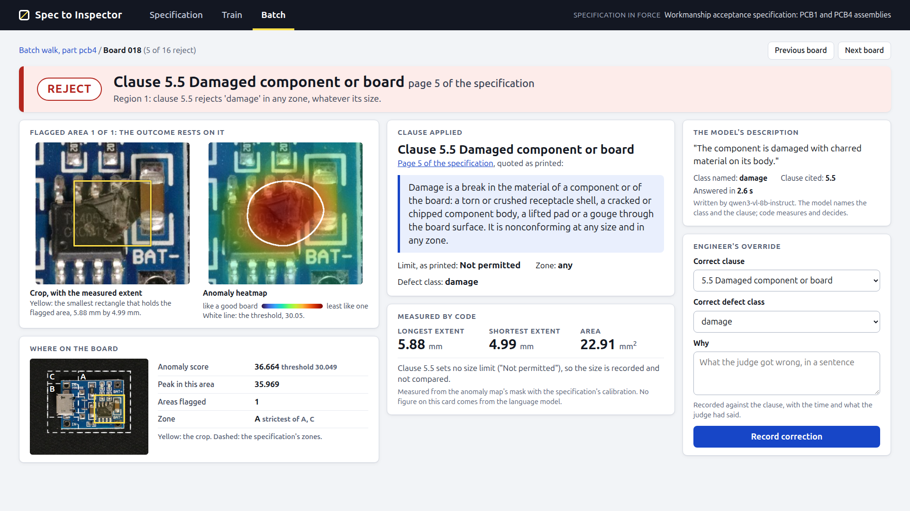
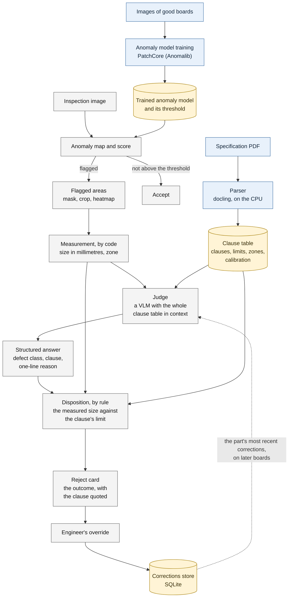
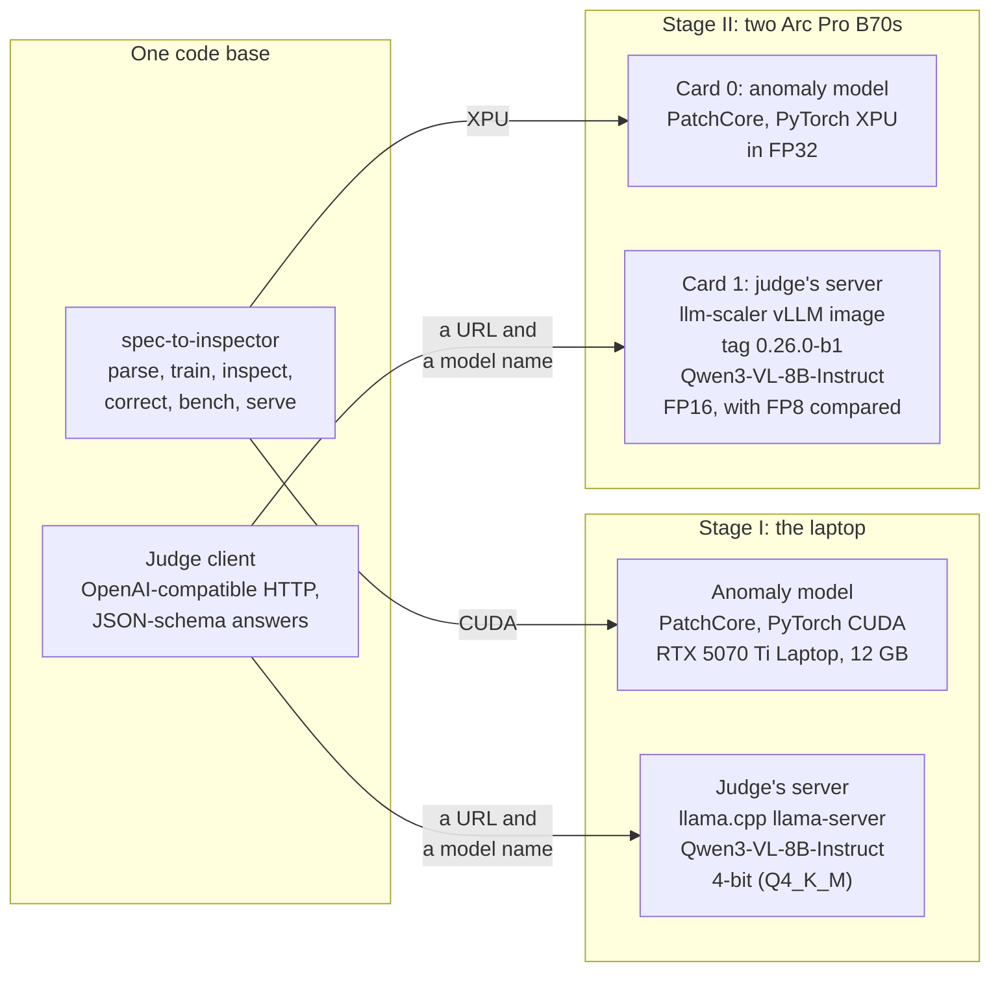

# Spec to Inspector

**A customer's defect specification becomes an inspector that cites the clause on every reject.**

- Demo video: <https://youtu.be/1RTXhtMX2sg>.
- Proposal deck (PDF): [`deck/deck.pdf`](deck/deck.pdf).

An entry to the ASUS UGen AI League Innovation Hackathon 2026: Workplace AI,
Battlefield Thunderstorm (ASUS UGen Intel Arc Pro B70 32GB). The prototype was
built and measured on a laptop in Stage I. **Stage II's subject is the
organiser's machine**, two Intel Arc Pro B70s, where the pipeline has run since
6 November 2026: its figures so far are a bring-up and the anomaly model's own,
and the final figure, under `eval/PROTOCOL-stage2.md`, has not been run yet.
A solo entry by Brian Isaac.



One reject from the prototype's console, from a real run. The crop, the
heatmap and the 5.88 mm come from the anomaly model and from code; the
defect class and the clause number come from the vision-language model; the
decision to reject is the clause's limit applied by code. The board is a
VisA test image (CC BY 4.0, see "Data"). It was picked by rule, as the first
board of the batch on which the model named the labelled defect; how often
it does is under "Results".

## How it works



1. **The specification is parsed once** into a typed clause table: each
   clause's defect class, zone, limit, unit and page, with the calibration
   that turns pixels into millimetres.
2. **An anomaly model learns "good" from good boards only**, and flags the
   areas of an inspected board that do not look like one.
3. **Code measures each flagged area**: its size in millimetres and the zone
   it lies in.
4. **A vision-language model names the defect class and the clause**, with
   the whole clause table in its context. It answers in a fixed JSON shape.
5. **A rule decides, and an engineer can correct.** Accept or reject is the
   clause's limit against the measured size. An override is stored and shown
   to the model on later boards of the same part.

**No number comes from the language model.** An answer that cites a clause
the part does not have, or a class that is not the clause's, becomes "needs
review", never a guess. `docs/architecture.md` has this diagram with each
stage's inputs and outputs, and a second diagram of the deployment.

## Results on the laptop

Stage I's figures, which are history for Stage II: nothing below is set against
the machine's. Measured on one laptop: NVIDIA GeForce RTX 5070 Ti Laptop GPU
(12 GB), Intel Core Ultra 9 275HX, Ubuntu 24.04, at 4-bit under llama.cpp, on the
PCB categories of the public VisA dataset. Every figure is in a tracked file under
`results/stage1/`, written by the command beside it.

**The headline: on the 135 single-defect VisA test boards of the two parts,
the prototype cites the right clause on 52 (38.5%; 95% interval 30.7% to
46.9%), scored on the most anomalous area, with an empty corrections
store.** That is low, and it is printed as measured. The anomaly model is
not what holds it down: on 109 of the 135 the most anomalous area lies on
the labelled defect. The model names the wrong defect class, most often
folding several classes into one or two per part. The pipeline around it
holds: 188 of 200 defective boards are rejected or referred, and every
reject rests on a real clause of the part and a size measured by code.

| Figure | Measured | Command |
| --- | --- | --- |
| Clause-citation accuracy, strict, single-defect boards | 38.5% (52 of 135), 95% interval 30.7% to 46.9% | A |
| The same, PCB1 only | 46.2% (42 of 91), 36.3% to 56.3% | A |
| The same, PCB4 only | 22.7% (10 of 44), 12.8% to 37.0% | A |
| Clause-citation accuracy, lenient, multi-defect boards | 58.5% (38 of 65), 46.3% to 69.6% | A |
| Defective boards rejected or referred to an engineer | 188 of 200 (174 rejected, 14 referred) | A |
| Good boards wrongly rejected | 8.0% (16 of 201), 5.0% to 12.5% | A |
| Image AUROC of the anomaly model: PCB1, PCB2, PCB3, PCB4 | 93.0, 92.3, 92.1, 98.7 | B |
| Anomaly model, images per second (the model alone) | 21.7 at batch 1, 25.1 at batch 16 | B |
| Anomaly model, training one part | 12 minutes; 7.82 GiB peak GPU memory | B |
| The VLM's answer to one flagged area, asked cold | median 3.33 s, p95 3.84 s (218 answers) | A |
| The same with the clause table cached by the server | median 2.55 s, p95 2.71 s (24 answers) | C |
| A flagged board, end to end | median 3.49 s, p95 4.03 s (216 boards) | A |
| A board that is not flagged | 86 ms | A |
| Peak GPU memory, the VLM server while judging | 8,780 MiB | A |
| Peak GPU memory, the whole card while judging | 10,109 MiB of 12,227 | A |
| From a new specification to a working inspector, one part | 12.3 minutes (8 s to parse, 12 minutes to train) | A |
| The demonstration specification | 6 pages, 16 clauses, 2,868 tokens | D |
| One correction, then the next similar board | cites the corrected clause in 7 pairs of 7 | E |

What each row may and may not be read as:

- **Strict accuracy** is the exact clause on the most anomalous area of a
  board with one labelled defect. A board that was not flagged, or got no
  valid answer, counts as wrong. For scale, a judge choosing at random
  among a part's clause headings would be right on a quarter of PCB1's
  boards (four headings) and a seventh of PCB4's (seven).
- **The lenient figure** counts a citation of any of a board's two or three
  defect types. It is not a second headline and is never pooled with the
  strict one.
- **Stopped boards.** The 12 defective boards that pass are the 12 the
  anomaly model did not flag. 14 are referred instead of decided, 8 of them
  because a size limit was cited on an area too small to measure.
- **False alarms.** The anomaly model flags 28 of the 201 good boards and
  the judge clears few of them: 16 are rejected, 9 referred, 3 accepted.
- **AUROC.** PatchCore through Anomalib, `wide_resnet50_2`, 256 px, one run.
  The Anomalib team's published ResNet18 figures at 256 px are 94.9, 92.4,
  99.0 and 99.0 (Rolih et al., arXiv 2403.04932, the mean of three runs).
  The comparison is to the published setting, not like for like in
  backbone. PCB3 is 6.9 points under its published figure and we could not
  reproduce that figure with the paper's own backbone either (91.8); the
  judge runs on PCB1 and PCB4 only. Read each AUROC as good to about half a
  point.
- **Memory.** The judge holds 8.8 GB and the anomaly model 2.0 GB while
  scoring; both fit in the laptop's 12 GB. Training (7.82 GiB) runs before
  the judge is loaded.
- **Corrections.** The engineer's correction is stored and shown to the
  judge, and a similar defect on another board then cites the corrected
  clause. The same single correction also moved 14 of 19 boards that were
  rightly judged before it, so this is not evidence that corrections raise
  accuracy, and nothing here claims they do.
- **Repeatability.** Run twice, the bench gave the same answer on every one
  of 401 boards.

**These are development figures, not held-out ones.** VisA's PCB test split
is the only labelled data: the anomaly model's thresholds were chosen on
it, and the judge's prompt was written with sight of some of its images.
There is one demonstration specification, one model at one quantisation and
one laptop. The labels are VisA's own defect annotation mapped to clauses
by a written table (`eval/clause_mapping.md`), 20 spot-checked by hand
against the image, all 20 agreeing (`eval/spot-check-2026-10-11.md`). The
protocol was written
before the run (`eval/PROTOCOL.md`), and `results/stage1/README.md` has
every figure with its confusion tables.

The commands, each run from the repository root after the quick start's
setup:

| | Command | Needs | Writes |
| --- | --- | --- | --- |
| A | `uv run spec-to-inspector bench` | the data, both trained models, the VLM server up; about 15 minutes | `results/stage1/bench.json` and `results/stage1/README.md` |
| B | `uv run spec-to-inspector train --all --bench --results results/stage1/anomaly.json` | the data and the GPU; about an hour | `results/stage1/anomaly.json` |
| C | `uv run python -m spec_to_inspector.judge.timing --category pcb4` | a scored PCB4 run and the VLM server up | `results/stage1/judge.json` |
| D | `uv run spec-to-inspector parse specs/pcb-spec.pdf --results results/stage1/spec.json` | nothing but the CPU | `results/stage1/spec.json` |
| E | `uv run python -m spec_to_inspector.corrections.live_check` | scored runs of both parts and the VLM server up; about 18 minutes | `results/stage1/corrections.json` |

Command A is Stage I's on the laptop and is history: it now stops at PCB1 `bad-029`, since the labelled set's region columns are the machine's by the protocol's addition of 7 November; Stage I's columns are in history at `8d1f28a`, with the SHA-256 `0477eb97...` that `results/stage1/bench.json` holds.

## Quick start

What you need: Linux on x86-64, [uv](https://docs.astral.sh/uv/) and git.
uv installs Python 3.12 itself. The first three steps need no GPU. This quick
start is the laptop's: training and judging here need an NVIDIA GPU with 12 GB
and a driver that supports CUDA 13 (580 or later). On the organiser's machine
they run on its Intel cards instead: see "Stage II on the Intel Arc Pro B70".

**1. Install, and check the build.** With an empty uv cache `uv sync`
fetches 186 packages, most of the bulk being PyTorch and its CUDA
libraries, and leaves about 6.8 GB on disk (a little over two minutes on a
fast connection); with a warm cache it takes seconds. The tests take about
three minutes on the laptop above.

```bash
git clone https://github.com/BrianIsaac/spec-to-inspector
cd spec-to-inspector
uv sync
uv run pytest && uv run ruff check && uv run ruff format --check && uv run pyright
```

The four commands are the project's gate. The tests that need the GPU, the
data or the VLM server are marked and left out of it, so it passes on a
clean clone.

**2. Parse the demonstration specification.** On the CPU, in under a
minute. The first run on a machine downloads docling's layout and table
models (about 530 MB) and the judge's tokenizer from Hugging Face. It
shows a `Loading weights` progress bar for docling's models, and may warn
that the requests are unauthenticated; no token is needed.

```bash
uv run spec-to-inspector parse specs/pcb-spec.pdf
```

It prints the clause table, then a line that begins `Parsed
specs/pcb-spec.pdf: 6 pages, 16 clauses under 11 numbered headings, 2,868
tokens` and goes on to name the tokenizer and the time taken. It writes
`specs/pcb-spec.clauses.json`, which is tracked: the file should come out
unchanged, so `git status` stays clean.

**3. Open the console.**

```bash
uv run spec-to-inspector serve --spec specs/pcb-spec.clauses.json
```

It runs in the foreground and prints its address. Open
<http://127.0.0.1:8130/>. The Specification page shows the PDF beside its
clause table, with a form to upload another PDF. The Train page offers to
start training and has no recorded run to show yet, and the Batch page says
no batch has been scored: both fill in once the next steps have run. Ctrl-C
stops the console. It has no login and listens on this machine only.

**4. Fetch the data.** VisA's four PCB categories, streamed from Amazon's
bucket and verified against the published counts: 1.9 GB read, about 1 GB
kept under `data/`. It needs GNU tar. A few minutes on a good day; the
bucket is sometimes much slower.

```bash
uv run spec-to-inspector data fetch
```

**5. Train the anomaly model for a part.** About 13 minutes on the laptop,
and about 8.7 GiB of GPU memory. It also scores the part's test split into
`runs/pcb4/test/`.

```bash
uv run spec-to-inspector train --category pcb4
```

**6. Start the judge's server.** The first start clones llama.cpp at a
pinned tag, builds it for CUDA (about 5 minutes; it needs CMake, a C++
compiler and the CUDA 13.0 toolkit, at `/usr/local/cuda-13.0` unless
`CUDA_ROOT` says otherwise) and downloads the weights (6.2 GB, checked
against pinned digests). It holds about 8.7 GiB of GPU memory, so start it
after training, not during.

```bash
scripts/serve_vlm.sh start
```

**7. Judge the boards, then look at them.** About 6 minutes for the 201
boards of the test split: only the flagged ones are put to the judge.

```bash
uv run spec-to-inspector inspect --category pcb4 --run runs/pcb4/test
scripts/serve_vlm.sh stop
uv run spec-to-inspector serve --spec specs/pcb-spec.clauses.json
```

`inspect` prints one line per board, such as `bad-000: reject, clause 5.7
Burn mark (page 5): ...`, and writes a `decision.json` beside each board's
result. In the console, Batch now lists the boards; a board opens its
reject card, where the override form records a correction. `inspect` also
takes image files in place of `--run`, and `uv run spec-to-inspector
inspect --help` lists the rest.

**8. Reproduce the figures.** Train PCB1 as well, start the server, and
run the bench (command A above).

```bash
uv run spec-to-inspector train --category pcb1
scripts/serve_vlm.sh start
uv run spec-to-inspector bench
scripts/serve_vlm.sh stop
```

Data, weights and run outputs live in `data/`, `models/` and `runs/`, all
ignored by git. To keep them elsewhere, set `SPEC_TO_INSPECTOR_DATA_DIR`,
`SPEC_TO_INSPECTOR_MODELS_DIR` and `SPEC_TO_INSPECTOR_RUNS_DIR`, in the
environment or in a `.env` file at the repository root.

## Model information

| Model | Role | Version | Size and precision | Licence | Stage I, the laptop | Stage II, the machine |
| --- | --- | --- | --- | --- | --- | --- |
| [Qwen3-VL-8B-Instruct](https://huggingface.co/Qwen/Qwen3-VL-8B-Instruct) | The judge: names the defect class and the clause | Stage I: Qwen's own [GGUF build](https://huggingface.co/Qwen/Qwen3-VL-8B-Instruct-GGUF), revision `f982a07`. Stage II: the same repository's weights, revision `0c351dd` | Stage I: 4-bit (Q4_K_M), 5.03 GB, with the F16 vision projector, 1.16 GB. Stage II: FP16, 16.33 GiB on disk, 17.34 GiB as vLLM loads it. Qwen's FP8, 10.59 GB, is a declared comparison and has not been run | Apache-2.0 | llama.cpp `llama-server` at tag `v0.6.0`, CUDA, 16K context | Intel's llm-scaler image, tag `0.26.0-b1`, vLLM 0.26.1.dev0, on card 1, 32K context |
| PatchCore, with a [`wide_resnet50_2`](https://huggingface.co/timm/wide_resnet50_2.racm_in1k) feature extractor | The anomaly model: finds what does not look like a good board | [Anomalib](https://github.com/open-edge-platform/anomalib) 2.7.0; timm's `wide_resnet50_2.racm_in1k` weights | 256 px input, full float32; a memory bank of 92,569 patches by 1,536 values, a 668 MB checkpoint per part | Apache-2.0 | PyTorch 2.14.1 CUDA | PyTorch 2.14.1 XPU in FP32, on card 0: 692.7 to 703.5 s to train a part and 10,345 to 10,785 MiB on the card at its peak (8 trainings); 34.69 to 35.22 images a second at batch 16, the model alone. Anomalib's OpenVINO export was measured beside it and is not the path: "Stage II on the Intel Arc Pro B70" has both |
| [docling](https://github.com/docling-project/docling)'s layout and table models | The parser: reads the specification PDF | as docling 2.135.0 fetches them: `docling-layout-heron`, `docling-models` v2.3.0 | about 530 MB together | Apache-2.0 and CDLA-Permissive-2.0 (docling itself is MIT) | CPU | CPU |
| [PaddleOCR-VL-1.6](https://huggingface.co/PaddlePaddle/PaddleOCR-VL-1.6) | Scanned specifications | not used in Stage I | 958.6M parameters | Apache-2.0 | not built | planned, at FP16; not run |

No model is trained or fine-tuned except PatchCore's memory bank, which is
built from a part's good images in about 12 minutes. `THIRD_PARTY.md` lists
every model, dataset and library with its licence and source.

## Stage II on the Intel Arc Pro B70

The machine is the subject of Stage II: the organiser's rules ask for operation
and validation on it, and no comparison with a team's own hardware. Week 1's
figures are in `results/stage2/week1/` and week 2's in `results/stage2/week2/`.
The protocol is `eval/PROTOCOL-stage2.md`, in force since 7 November 2026, with one
dated addition so far, and the plan, corrected to the machine, is in full in
`docs/stage2.md`:



Every line has run. On the machine that means the judge at FP16, and PatchCore
trained and scored on XPU in FP32, on all four parts, in two runs. Anomalib's
OpenVINO export has run too and is measured below; nothing in the pipeline runs
through it. The judge at FP8, the bench on the models trained on the machine and
the final run have not run.

- **The machine.** Two whole Arc Pro B70s of 32,656 MiB each in one bare-metal
  host, not a virtual machine, reached over ssh, with outbound HTTPS open
  (`results/stage2/week1/machine.md`). The plan had assumed one whole card in a
  booked remote session.
- **The memory plan.** A card each, so training need not come before the judge
  is loaded, and week 2 trained with the judge's server up on card 1. The judge's
  server takes 90% of card 1: at 80% FP16 leaves 2.97 GiB of cache and vLLM refuses
  a 32K-token context; at 90% it leaves 6.16 GiB, 44,800 tokens. The anomaly model
  holds 2,899 to 2,963 MiB of card 0 while scoring, 4,069 MiB at most in the process
  that has just trained, and 10,345 to 10,785 MiB at its peak in training. At FP8
  the cache is an estimate, not a measurement: about 13 GiB at 90%. The plan had
  assumed 80% of one shared card and about 8 GB of cache at FP16.
- **The serving stack.** Moving the client from llama.cpp to the llm-scaler vLLM
  image is two settings. The server needs two more of its own or it is not the
  pipeline the protocol declares: asked cold (`--no-enable-prefix-caching
  --mm-processor-cache-gb 0`) and a small crop's 1,024 tokens. vLLM accepts the
  answer schema, with one fix to the schema: the reason's pattern now bars the
  double quote and the backslash. The anomaly model's device is a setting,
  `SPEC_TO_INSPECTOR_DEVICE`. With the laptop's checkpoints, PatchCore's scores on
  XPU match CUDA's on all 802 boards of the four parts to within 0.00053; that is
  inference alone, and training on XPU moves a handful of boards further
  (`results/stage2/week2/README.md`).
- **Running there.** `scripts/setup_xpu.sh` syncs the `xpu` dependency group, and
  `scripts/serve_vlm_xpu.sh start` starts the judge's server. Set
  `SPEC_TO_INSPECTOR_DEVICE=xpu` and run from `.venv/bin/`: a bare `uv run` syncs
  back to the default groups and swaps in the CUDA wheels.
- **The first bench.** A bring-up figure, never final: 34.1% strict (46 of 135,
  95% interval 26.6% to 42.4%) and lenient 70.8% (46 of 65, 58.8% to 80.4%), with
  the laptop's anomaly checkpoints.
- **The final figure.** One setting declared in the protocol before the run, FP16,
  with the anomaly models trained on the machine and an empty corrections store,
  reported whatever it reads; three runs, the third after a server restart. It has
  not been run yet. Before it is, the bench's region columns, made from the laptop's
  models, are regenerated from the machine's, on which the bench now stops at PCB1
  `bad-029`; the threshold rule stays a strict `>`, with the four boards that sit on
  the threshold named in the record. A dated addition to the protocol,
  `eval/PROTOCOL-stage2-addition-region-columns-2026-11-07.md`, says both. Three
  comparisons are declared in files of their own: FP8, the model's own image minimum,
  and designators let through the digit ban, which stays in the final figure. A figure
  is said to have moved only on a paired, two-sided exact sign test below 0.05 on the
  135.
- **What will be measured**, 6 November to 4 December, when the video is due, with
  the machine's reservation ending 2 December at 11:30, so everything run on it and
  the recording of the final video come before then: the judge's answer time and
  throughput at FP16 and FP8; and clause-citation accuracy on the 200 labelled boards,
  to see whether FP8, a picture of a good board beside the crop, and the corrections
  loop move the machine's own baseline. The last two each get a dated addition to the
  protocol when built.

**The anomaly model on the machine**, measured on card 0 on 6 November 2026 with the
judge's server up on card 1 (`results/stage2/week2/README.md`, which has every command).
Stage I's settings: `wide_resnet50_2`, 256 px, 10% coreset, seed 0, FP32. PyTorch XPU is
the path; OpenVINO is measured beside it and nothing in the pipeline runs through it.

| Figure | PyTorch XPU | OpenVINO on `GPU.0`, FP32 |
| --- | --- | --- |
| Training, whole fit | 692.7 to 703.5 s; 8 trainings, each part twice | Not measured: nothing trains through OpenVINO |
| Export, then compile, batch 16 | | 12.0 to 15.2 s, then 32.7 to 33.8 s; 8 each |
| Export, then compile, batch 1 | | 10.1 to 10.7 s, then 5.1 to 6.1 s; 8 each |
| Peak in training, PyTorch's count: allocated, reserved | 7.76 to 7.79 GiB, 8.87 to 8.91 GiB; 8 | Not measured |
| Peak in training, the whole card | 10,345 to 10,785 MiB; 8 | Not measured |
| Images a second, the model alone, batch 1 | 29.61 to 30.04; passes 29.59 to 30.10 | 14.28 to 16.22; passes 14.27 to 16.31 |
| The same, batch 16 | 34.69 to 35.22; passes 34.68 to 35.22 | 16.20 to 18.69; passes 16.18 to 18.75 |
| Images a second, from the files, batch 1 | 25.93 to 26.36; passes 25.83 to 26.51 | 13.39 to 15.26; passes 13.36 to 15.30 |
| The same, batch 16 | 29.46 to 30.42; passes 29.40 to 30.44 | 14.99 to 17.26; passes 14.96 to 17.37 |
| Peak scoring, the whole card | 2,899 to 2,963 MiB over both batches; 4,005 to 4,069 MiB in a scored run, in the process that had just trained; 8 each | Batch 16: 18,153 to 18,400 MiB. Batch 1: 2,700 to 2,943 MiB; 8 each |
| Flagged boards: PCB1, PCB2, PCB3, PCB4 | 111, 104, 105, 106 | 110, 104, 105, 107 |
| Image AUROC of the scored run, in points | 93.05, 92.32, 92.08, 98.71 | 93.05, 92.33, 92.08, 98.71 |
| The same run repeated | Scores and maps bit-identical, memory banks identical, 802 boards | Scores and maps bit-identical, 802 boards |

A range is over the four parts in both runs, and "passes" is every timed pass behind it,
3 a figure. "The model alone" is not quite the same clock in the two columns: PyTorch's
batches are on the card before the clock starts and OpenVINO's are copied from the host
inside it, so "from the files" is the like-for-like row. OpenVINO's scores are within
0.00041 of PyTorch XPU's. The two differences in the flagged row are one board each, a
board on its threshold. One machine, one card, one seed, on the VisA test split the
thresholds were chosen on: nothing here is a general figure for the B70, and none is a
final figure of the pipeline.

## Data

**VisA.** The boards are the PCB categories of the Visual Anomaly dataset,
released by Amazon under the Creative Commons Attribution 4.0 licence
(<https://github.com/amazon-science/spot-diff>):

> Yang Zou, Jongheon Jeong, Latha Pemula, Dongqing Zhang and Onkar Dabeer.
> "SPot-the-Difference Self-Supervised Pre-training for Anomaly Detection
> and Segmentation." ECCV 2022. arXiv:2207.14315.

The dataset is not in this repository; `data fetch` downloads it. The
pictures in `specs/figures/`, in the specification's PDF, in the
screenshot above and in the deck's PDF are VisA images, cropped, resized or
drawn over, and
`eval/clause_labels.csv` is VisA's defect annotation mapped to clauses.

**The demonstration specification.** `specs/pcb-spec.md` and its PDF were
written for this entry, in the style of a customer's workmanship
specification. It is not a real customer's document. Its parts are the
boards VisA photographed, its limits are illustrative, and it neither
quotes nor paraphrases any published standard.

## What is in the repository

```
src/spec_to_inspector/
    spec/          specification PDF to clauses: the schema and the parser
    anomaly/       PatchCore training and scoring; maps, masks and crops
    measure/       calibration, defect size in millimetres, zone lookup
    judge/         the VLM client, the prompt, the answer, the rule, the decision
    corrections/   the engineer's overrides, stored and recalled
    app/           the inspection console (FastAPI, server-rendered)
    bench/         the measurement harness behind the figures above
    cli.py         one entry point: parse, train, inspect, correct, bench, serve
tests/             mirrors src/
specs/             the demonstration specification: Markdown source, PDF, clause table
eval/              the labelled clause set, its mapping table, the two protocols and
                   the second's dated addition
results/stage1/    the laptop's measured figures, as JSON, and the page written from them
results/stage2/    the machine's: its shape, week 1's bring-up figures and logs,
                   week 2's anomaly model
scripts/           the judge's two servers, the machine's environment, the
                   specification's rebuild, the console walk
docs/              architecture.md, stage2.md, and the reject card's screenshot
deck/deck.pdf      the proposal deck
```

## Licences

The code and documents written for this project are under the Apache
License 2.0 (`LICENSE`), copyright 2026 Brian Isaac. `THIRD_PARTY.md` lists
every model, dataset and library the project uses, with its licence and its
source. None is under a non-commercial licence.

The gate, run before every commit:

```bash
uv run pytest && uv run ruff check && uv run ruff format --check && uv run pyright
```

Tests that need more than a clean clone are marked and run on request:
`uv run pytest -m gpu` (the CUDA GPU), `-m xpu` (the Intel Arc cards and the
`xpu` environment), `-m data` (the fetched data), `-m live` and `-m bench` (the
VLM server up), `-m recorded` (trained models and scored runs).
