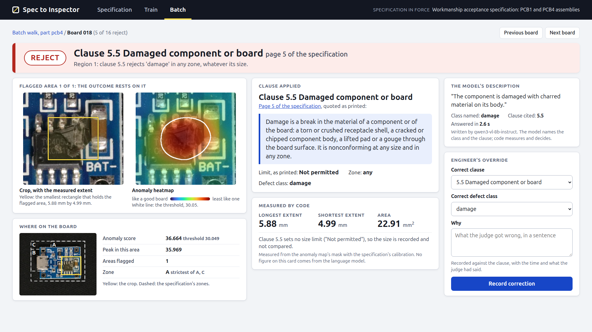
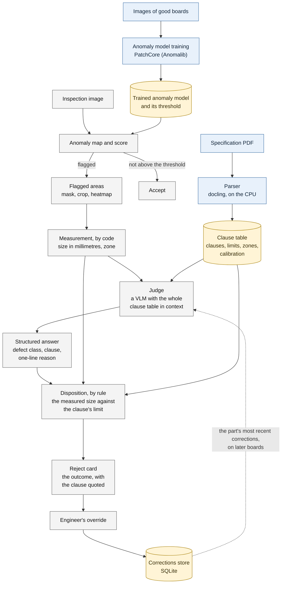
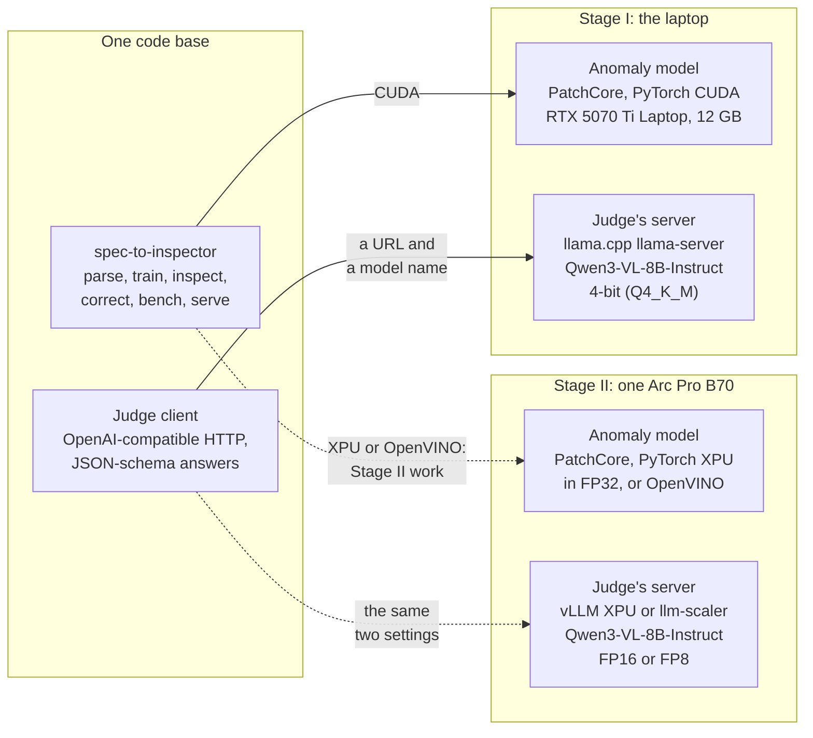

# Spec to Inspector

**A customer's defect specification becomes an inspector that cites the clause on every reject.**

- Demo video: added before submission.
- Proposal deck (PDF): [`deck/deck.pdf`](deck/deck.pdf).

An entry to the ASUS UGen AI League Innovation Hackathon 2026: Workplace AI,
Battlefield Thunderstorm (ASUS UGen Intel Arc Pro B70 32GB). This repository
is the Stage I prototype. It was built and measured on a laptop; nothing in
it has run on a B70 yet, and every B70 figure below is marked as a plan.
A solo entry by Brian Isaac.



One reject from the prototype's console, from a real run. The crop, the
heatmap and the 5.88 mm come from the anomaly model and from code; the
defect class and the clause number come from the vision-language model; the
decision to reject is the clause's limit applied by code. The board is a
VisA test image (CC BY 4.0, see "Data"). It was picked by rule, as the first
board of the batch on which the model named the labelled defect; how often
it does is under "Results".

## How it works



1. **The specification is parsed once** into a typed clause table: each
   clause's defect class, zone, limit, unit and page, with the calibration
   that turns pixels into millimetres.
2. **An anomaly model learns "good" from good boards only**, and flags the
   areas of an inspected board that do not look like one.
3. **Code measures each flagged area**: its size in millimetres and the zone
   it lies in.
4. **A vision-language model names the defect class and the clause**, with
   the whole clause table in its context. It answers in a fixed JSON shape.
5. **A rule decides, and an engineer can correct.** Accept or reject is the
   clause's limit against the measured size. An override is stored and shown
   to the model on later boards of the same part.

**No number comes from the language model.** An answer that cites a clause
the part does not have, or a class that is not the clause's, becomes "needs
review", never a guess. `docs/architecture.md` has this diagram with each
stage's inputs and outputs, and a second diagram of the deployment.

## Results on the laptop

Measured on one laptop: NVIDIA GeForce RTX 5070 Ti Laptop GPU (12 GB), Intel
Core Ultra 9 275HX, Ubuntu 24.04, on the PCB categories of the public VisA
dataset. Every figure is in a tracked file under `results/stage1/`, written
by the command beside it.

**The headline: on the 135 single-defect VisA test boards of the two parts,
the prototype cites the right clause on 52 (38.5%; 95% interval 30.7% to
46.9%), scored on the most anomalous area, with an empty corrections
store.** That is low, and it is printed as measured. The anomaly model is
not what holds it down: on 109 of the 135 the most anomalous area lies on
the labelled defect. The model names the wrong defect class, most often
folding several classes into one or two per part. The pipeline around it
holds: 188 of 200 defective boards are rejected or referred, and every
reject rests on a real clause of the part and a size measured by code.

| Figure | Measured | Command |
| --- | --- | --- |
| Clause-citation accuracy, strict, single-defect boards | 38.5% (52 of 135), 95% interval 30.7% to 46.9% | A |
| The same, PCB1 only | 46.2% (42 of 91), 36.3% to 56.3% | A |
| The same, PCB4 only | 22.7% (10 of 44), 12.8% to 37.0% | A |
| Clause-citation accuracy, lenient, multi-defect boards | 58.5% (38 of 65), 46.3% to 69.6% | A |
| Defective boards rejected or referred to an engineer | 188 of 200 (174 rejected, 14 referred) | A |
| Good boards wrongly rejected | 8.0% (16 of 201), 5.0% to 12.5% | A |
| Image AUROC of the anomaly model: PCB1, PCB2, PCB3, PCB4 | 93.0, 92.3, 92.1, 98.7 | B |
| Anomaly model, images per second (the model alone) | 21.7 at batch 1, 25.1 at batch 16 | B |
| Anomaly model, training one part | 12 minutes; 7.82 GiB peak GPU memory | B |
| The VLM's answer to one flagged area, asked cold | median 3.33 s, p95 3.84 s (218 answers) | A |
| The same with the clause table cached by the server | median 2.55 s, p95 2.71 s (24 answers) | C |
| A flagged board, end to end | median 3.49 s, p95 4.03 s (216 boards) | A |
| A board that is not flagged | 86 ms | A |
| Peak GPU memory, the VLM server while judging | 8,780 MiB | A |
| Peak GPU memory, the whole card while judging | 10,109 MiB of 12,227 | A |
| From a new specification to a working inspector, one part | 12.3 minutes (8 s to parse, 12 minutes to train) | A |
| The demonstration specification | 6 pages, 16 clauses, 2,868 tokens | D |
| One correction, then the next similar board | cites the corrected clause in 7 pairs of 7 | E |

What each row may and may not be read as:

- **Strict accuracy** is the exact clause on the most anomalous area of a
  board with one labelled defect. A board that was not flagged, or got no
  valid answer, counts as wrong. For scale, a judge choosing at random
  among a part's clause headings would be right on a quarter of PCB1's
  boards (four headings) and a seventh of PCB4's (seven).
- **The lenient figure** counts a citation of any of a board's two or three
  defect types. It is not a second headline and is never pooled with the
  strict one.
- **Stopped boards.** The 12 defective boards that pass are the 12 the
  anomaly model did not flag. 14 are referred instead of decided, 8 of them
  because a size limit was cited on an area too small to measure.
- **False alarms.** The anomaly model flags 28 of the 201 good boards and
  the judge clears few of them: 16 are rejected, 9 referred, 3 accepted.
- **AUROC.** PatchCore through Anomalib, `wide_resnet50_2`, 256 px, one run.
  The Anomalib team's published ResNet18 figures at 256 px are 94.9, 92.4,
  99.0 and 99.0 (Rolih et al., arXiv 2403.04932, the mean of three runs).
  The comparison is to the published setting, not like for like in
  backbone. PCB3 is 6.9 points under its published figure and we could not
  reproduce that figure with the paper's own backbone either (91.8); the
  judge runs on PCB1 and PCB4 only. Read each AUROC as good to about half a
  point.
- **Memory.** The judge holds 8.8 GB and the anomaly model 2.0 GB while
  scoring; both fit in the laptop's 12 GB. Training (7.82 GiB) runs before
  the judge is loaded.
- **Corrections.** The engineer's correction is stored and shown to the
  judge, and a similar defect on another board then cites the corrected
  clause. The same single correction also moved 14 of 19 boards that were
  rightly judged before it, so this is not evidence that corrections raise
  accuracy, and nothing here claims they do.
- **Repeatability.** Run twice, the bench gave the same answer on every one
  of 401 boards.

**These are development figures, not held-out ones.** VisA's PCB test split
is the only labelled data: the anomaly model's thresholds were chosen on
it, and the judge's prompt was written with sight of some of its images.
There is one demonstration specification, one model at one quantisation and
one laptop. The labels are VisA's own defect annotation mapped to clauses
by a written table (`eval/clause_mapping.md`), 20 spot-checked by hand
against the image, all 20 agreeing (`eval/spot-check-2026-10-11.md`). The
protocol was written
before the run (`eval/PROTOCOL.md`), and `results/stage1/README.md` has
every figure with its confusion tables.

The commands, each run from the repository root after the quick start's
setup:

| | Command | Needs | Writes |
| --- | --- | --- | --- |
| A | `uv run spec-to-inspector bench` | the data, both trained models, the VLM server up; about 15 minutes | `results/stage1/bench.json` and `results/stage1/README.md` |
| B | `uv run spec-to-inspector train --all --bench --results results/stage1/anomaly.json` | the data and the GPU; about an hour | `results/stage1/anomaly.json` |
| C | `uv run python -m spec_to_inspector.judge.timing --category pcb4` | a scored PCB4 run and the VLM server up | `results/stage1/judge.json` |
| D | `uv run spec-to-inspector parse specs/pcb-spec.pdf --results results/stage1/spec.json` | nothing but the CPU | `results/stage1/spec.json` |
| E | `uv run python -m spec_to_inspector.corrections.live_check` | scored runs of both parts and the VLM server up; about 18 minutes | `results/stage1/corrections.json` |

## Quick start

What you need: Linux on x86-64, [uv](https://docs.astral.sh/uv/) and git.
uv installs Python 3.12 itself. The first three steps need no GPU. Training
and judging need an NVIDIA GPU with 12 GB and a driver that supports CUDA
13 (580 or later); they were run on the laptop named above and nowhere
else.

**1. Install, and check the build.** With an empty uv cache `uv sync`
fetches 180 packages, most of the bulk being PyTorch and its CUDA
libraries, and leaves about 6.3 GB on disk (a little over two minutes on a
fast connection); with a warm cache it takes seconds. The tests take four
to five minutes on the laptop above.

```bash
git clone https://github.com/BrianIsaac/spec-to-inspector
cd spec-to-inspector
uv sync
uv run pytest && uv run ruff check && uv run ruff format --check && uv run pyright
```

The four commands are the project's gate. The tests that need the GPU, the
data or the VLM server are marked and left out of it, so it passes on a
clean clone.

**2. Parse the demonstration specification.** On the CPU, in under a
minute. The first run on a machine downloads docling's layout and table
models (about 530 MB) and the judge's tokenizer from Hugging Face. It
shows a `Loading weights` progress bar for docling's models, and may warn
that the requests are unauthenticated; no token is needed.

```bash
uv run spec-to-inspector parse specs/pcb-spec.pdf
```

It prints the clause table, then a line that begins `Parsed
specs/pcb-spec.pdf: 6 pages, 16 clauses under 11 numbered headings, 2,868
tokens` and goes on to name the tokenizer and the time taken. It writes
`specs/pcb-spec.clauses.json`, which is tracked: the file should come out
unchanged, so `git status` stays clean.

**3. Open the console.**

```bash
uv run spec-to-inspector serve --spec specs/pcb-spec.clauses.json
```

It runs in the foreground and prints its address. Open
<http://127.0.0.1:8130/>. The Specification page shows the PDF beside its
clause table, with a form to upload another PDF. The Train page offers to
start training and has no recorded run to show yet, and the Batch page says
no batch has been scored: both fill in once the next steps have run. Ctrl-C
stops the console. It has no login and listens on this machine only.

**4. Fetch the data.** VisA's four PCB categories, streamed from Amazon's
bucket and verified against the published counts: 1.9 GB read, about 1 GB
kept under `data/`. It needs GNU tar. A few minutes on a good day; the
bucket is sometimes much slower.

```bash
uv run spec-to-inspector data fetch
```

**5. Train the anomaly model for a part.** About 13 minutes on the laptop,
and about 8.7 GiB of GPU memory. It also scores the part's test split into
`runs/pcb4/test/`.

```bash
uv run spec-to-inspector train --category pcb4
```

**6. Start the judge's server.** The first start clones llama.cpp at a
pinned tag, builds it for CUDA (about 5 minutes; it needs CMake, a C++
compiler and the CUDA 13.0 toolkit, at `/usr/local/cuda-13.0` unless
`CUDA_ROOT` says otherwise) and downloads the weights (6.2 GB, checked
against pinned digests). It holds about 8.7 GiB of GPU memory, so start it
after training, not during.

```bash
scripts/serve_vlm.sh start
```

**7. Judge the boards, then look at them.** About 6 minutes for the 201
boards of the test split: only the flagged ones are put to the judge.

```bash
uv run spec-to-inspector inspect --category pcb4 --run runs/pcb4/test
scripts/serve_vlm.sh stop
uv run spec-to-inspector serve --spec specs/pcb-spec.clauses.json
```

`inspect` prints one line per board, such as `bad-000: reject, clause 5.7
Burn mark (page 5): ...`, and writes a `decision.json` beside each board's
result. In the console, Batch now lists the boards; a board opens its
reject card, where the override form records a correction. `inspect` also
takes image files in place of `--run`, and `uv run spec-to-inspector
inspect --help` lists the rest.

**8. Reproduce the figures.** Train PCB1 as well, start the server, and
run the bench (command A above).

```bash
uv run spec-to-inspector train --category pcb1
scripts/serve_vlm.sh start
uv run spec-to-inspector bench
scripts/serve_vlm.sh stop
```

Data, weights and run outputs live in `data/`, `models/` and `runs/`, all
ignored by git. To keep them elsewhere, set `SPEC_TO_INSPECTOR_DATA_DIR`,
`SPEC_TO_INSPECTOR_MODELS_DIR` and `SPEC_TO_INSPECTOR_RUNS_DIR`, in the
environment or in a `.env` file at the repository root.

## Model information

| Model | Role | Version | Size and precision | Licence | Stage I, the laptop | Stage II, the B70 (planned) |
| --- | --- | --- | --- | --- | --- | --- |
| [Qwen3-VL-8B-Instruct](https://huggingface.co/Qwen/Qwen3-VL-8B-Instruct) | The judge: names the defect class and the clause | Stage I: Qwen's own [GGUF build](https://huggingface.co/Qwen/Qwen3-VL-8B-Instruct-GGUF), revision `f982a07` | Stage I: 4-bit (Q4_K_M), 5.03 GB, with the F16 vision projector, 1.16 GB. Stage II: FP16, 17.53 GB, or Qwen's FP8, 10.59 GB | Apache-2.0 | llama.cpp `llama-server` at tag `v0.6.0`, CUDA, 16K context | vLLM's XPU build or Intel's llm-scaler image |
| PatchCore, with a [`wide_resnet50_2`](https://huggingface.co/timm/wide_resnet50_2.racm_in1k) feature extractor | The anomaly model: finds what does not look like a good board | [Anomalib](https://github.com/open-edge-platform/anomalib) 2.7.0; timm's `wide_resnet50_2.racm_in1k` weights | 256 px input, full float32; a memory bank of 92,569 patches by 1,536 values, a 668 MB checkpoint per part | Apache-2.0 | PyTorch 2.14.1 CUDA | PyTorch XPU in FP32, or OpenVINO |
| [docling](https://github.com/docling-project/docling)'s layout and table models | The parser: reads the specification PDF | as docling 2.135.0 fetches them: `docling-layout-heron`, `docling-models` v2.3.0 | about 530 MB together | Apache-2.0 and CDLA-Permissive-2.0 (docling itself is MIT) | CPU | CPU |
| [PaddleOCR-VL-1.6](https://huggingface.co/PaddlePaddle/PaddleOCR-VL-1.6) | Scanned specifications | not used in Stage I | 958.6M parameters | Apache-2.0 | not built | planned, at FP16 |

No model is trained or fine-tuned except PatchCore's memory bank, which is
built from a part's good images in about 12 minutes. `THIRD_PARTY.md` lists
every model, dataset and library with its licence and source.

## Stage II on the Intel Arc Pro B70

Nothing here has run on a B70. The plan, in full in `docs/stage2.md`:



Solid lines run today; dotted lines are the plan.

- **The assumption about the organiser's VM.** Its specification is not yet
  published. We plan for one whole Arc Pro B70 (32 GB) reached through a
  booked remote session, with no camera or USB device and limited outbound
  network. If the VM gives a share of a card instead, the judge drops to a
  4-bit build, the stages run strictly in turn, and clauses are retrieved
  instead of the whole specification being held in context.
- **The memory plan.** Training runs first and alone (7.82 GiB on the
  laptop). During a batch the judge's server takes 80% of the card, 25.6
  GB, and the anomaly model has the remaining 6.4 GB, several times what it
  needed on the laptop. At FP16 the judge's weights are 17.53 GB, leaving
  about 8 GB of context cache, enough for one 32K-token context; at FP8,
  10.59 GB, leaving room for three. These are planned from file sizes and
  the model's configuration, to be measured on the VM.
- **The serving stack.** The judge's client already speaks the
  OpenAI-compatible API, so moving from llama.cpp to vLLM or llm-scaler is
  two settings. The anomaly code asks for CUDA today; PyTorch XPU or
  OpenVINO is Stage II work.
- **What will be measured**, 6 November to 4 December: the VM's real shape;
  PatchCore's training time, speed and memory on the B70; the judge's answer
  time and throughput at FP16 and FP8; and clause-citation accuracy on the
  same 200 labelled boards, by the same protocol, to see whether full
  precision, a picture of a good board beside the crop, and the corrections
  loop move the 38.5%.

## Data

**VisA.** The boards are the PCB categories of the Visual Anomaly dataset,
released by Amazon under the Creative Commons Attribution 4.0 licence
(<https://github.com/amazon-science/spot-diff>):

> Yang Zou, Jongheon Jeong, Latha Pemula, Dongqing Zhang and Onkar Dabeer.
> "SPot-the-Difference Self-Supervised Pre-training for Anomaly Detection
> and Segmentation." ECCV 2022. arXiv:2207.14315.

The dataset is not in this repository; `data fetch` downloads it. The
pictures in `specs/figures/`, in the specification's PDF and in
`docs/screens/` are VisA images, cropped, resized or drawn over, and
`eval/clause_labels.csv` is VisA's defect annotation mapped to clauses.

**The demonstration specification.** `specs/pcb-spec.md` and its PDF were
written for this entry, in the style of a customer's workmanship
specification. It is not a real customer's document. Its parts are the
boards VisA photographed, its limits are illustrative, and it neither
quotes nor paraphrases any published standard.

## What is in the repository

```
src/spec_to_inspector/
    spec/          specification PDF to clauses: the schema and the parser
    anomaly/       PatchCore training and scoring; maps, masks and crops
    measure/       calibration, defect size in millimetres, zone lookup
    judge/         the VLM client, the prompt, the answer, the rule, the decision
    corrections/   the engineer's overrides, stored and recalled
    app/           the inspection console (FastAPI, server-rendered)
    bench/         the measurement harness behind the figures above
    cli.py         one entry point: parse, train, inspect, correct, bench, serve
tests/             mirrors src/
specs/             the demonstration specification: Markdown source, PDF, clause table
eval/              the labelled clause set, its mapping table and the protocol
results/stage1/    the measured figures, as JSON, and the page written from them
scripts/           the judge's server, the specification's rebuild, the console walk
docs/              architecture.md, stage2.md, and the console's screenshots
```

## Licences

The code and documents written for this project are under the Apache
License 2.0 (`LICENSE`), copyright 2026 Brian Isaac. `THIRD_PARTY.md` lists
every model, dataset and library the project uses, with its licence and its
source. None is under a non-commercial licence.

The gate, run before every commit:

```bash
uv run pytest && uv run ruff check && uv run ruff format --check && uv run pyright
```

Tests that need more than a clean clone are marked and run on request:
`uv run pytest -m gpu` (the CUDA GPU), `-m data` (the fetched data),
`-m live` and `-m bench` (the VLM server up), `-m recorded` (trained models
and scored runs).
