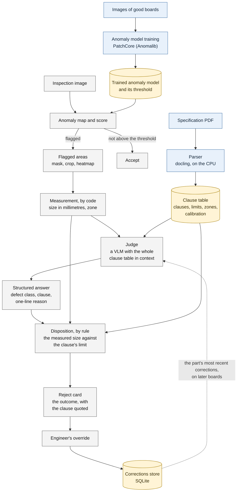
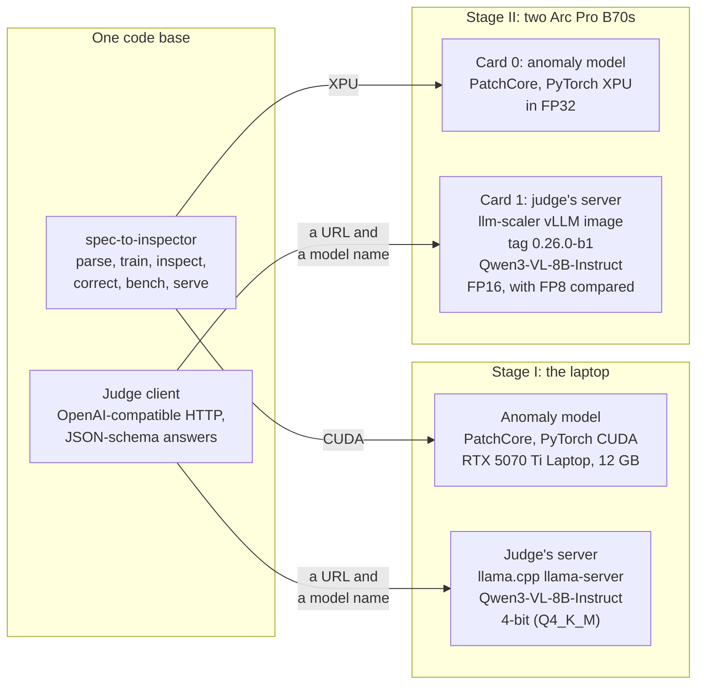

# Spec to Inspector

**A customer's defect specification becomes an inspector that cites the clause on every reject.**

- Demo video: <https://youtu.be/1RTXhtMX2sg>.
- Proposal deck (PDF): [`deck/deck.pdf`](deck/deck.pdf).

An entry to the ASUS UGen AI League Innovation Hackathon 2026: Workplace AI,
Battlefield Thunderstorm (ASUS UGen Intel Arc Pro B70 32GB). The prototype was
built and measured on a laptop in Stage I. **Stage II's subject is the
organiser's machine**, two Intel Arc Pro B70s, where the pipeline has run since
6 November 2026. Its final figure, under `eval/PROTOCOL-stage2.md`, ran on 7
November 2026: strict clause-citation accuracy 34.1%, 46 of 135, 95% interval
26.6% to 42.4% (see "Results on the machine"). A solo entry by Brian Isaac.


One reject from the prototype's console, from a real run. The crop, the
heatmap and the 5.88 mm come from the anomaly model and from code; the
defect class and the clause number come from the vision-language model; the
decision to reject is the clause's limit applied by code. The board is a
VisA test image (CC BY 4.0, see "Data"). It was picked by rule, as the first
board of the batch on which the model named the labelled defect; how often
it does is under "Results on the laptop".

## How it works



1. **The specification is parsed once** into a typed clause table: each
   clause's defect class, zone, limit, unit and page, with the calibration
   that turns pixels into millimetres.
2. **An anomaly model learns "good" from good boards only**, and flags the
   areas of an inspected board that do not look like one.
3. **Code measures each flagged area**: its size in millimetres and the zone
   it lies in.
4. **A vision-language model names the defect class and the clause**, with
   the whole clause table in its context. It answers in a fixed JSON shape.
5. **A rule decides, and an engineer can correct.** Accept or reject is the
   clause's limit against the measured size. An override is stored and shown
   to the model on later boards of the same part.

**No number comes from the language model.** An answer that cites a clause
the part does not have, or a class that is not the clause's, becomes "needs
review", never a guess. `docs/architecture.md` has this diagram with each
stage's inputs and outputs, and a second diagram of the deployment.

## Results on the machine

The final run of Stage II, on 7 November 2026, on the organiser's machine: two
Intel Arc Pro B70s of 32,656 MiB each in one bare-metal host. It follows
`eval/PROTOCOL-stage2.md` and the two dated additions then in force: one setting declared
before the run, FP16, with the anomaly models trained on the machine and an empty corrections
store, reported whatever it reads. It is not the best of several settings. Every figure
below is copied from the records named at the end of this section.

**The final figure: strict clause-citation accuracy, 34.1%. The judge cited the
right clause on 46 of the 135 single-defect boards, 95% interval 26.6% to 42.4%,
scored on the most anomalous area.**

**The lenient figure, under its own name and never pooled with the strict one: 70.8%,
46 of 65 multi-defect boards, 58.8% to 80.4%.** It counts a citation of any of the
board's defect types, and it claims only that.

| Figure | Measured |
| --- | --- |
| Clause-citation accuracy, strict, single-defect boards | 34.1% (46 of 135), 26.6% to 42.4% |
| The same, PCB1 only | 45.1% (41 of 91), 35.2% to 55.3% |
| The same, PCB4 only | 11.4% (5 of 44), 5.0% to 24.0% |
| The lenient figure, multi-defect boards | 70.8% (46 of 65), 58.8% to 80.4% |
| The per-region figure: boards with one defect type under the most anomalous area | 36.2% (54 of 149), 29.0% to 44.2% |
| Single-defect boards flagged by the anomaly model | 93.3% (126 of 135), 87.8% to 96.5% |
| The most anomalous area lies on the labelled defect | 81.5% (110 of 135), 74.1% to 87.1% |
| Strict accuracy on the flagged boards only, conditional | 36.5% (46 of 126), 28.6% to 45.2% |
| Strict accuracy where that area lies on the defect, conditional | 38.2% (42 of 110), 29.6% to 47.5% |
| Good boards rejected, the false rejects | 8.0% (16 of 201), 5.0% to 12.5% |
| Good boards flagged by the anomaly model | 13.9% (28 of 201), 9.8% to 19.4% |
| The judge's answer to one area, asked cold | median 2.12 s, p95 2.54 s (217 answers) |
| A flagged board, end to end | median 2.33 s, p95 2.73 s (217 boards) |
| Peak on card 0, the anomaly model | 2,594 MiB |
| Peak on card 1, the judge | 29,471 MiB; 29,784 MiB after the restart |
| From a new specification to a working inspector, one part | 11.8 minutes: the parse measured here, the fit as recorded at training and not repeated |

Every proportion is a count of its N with the 95% Wilson score interval. The times and
the first peak on card 1 are the tracked run's, the second of the three below.

**Three runs agree on every counted figure.** All three are the protocol's one declared
setting, and the third came after the protocol's server restart. Across figures 1 to 6,
343 fields, none differs. Each run against the one before: 401 images, 0 flags, 0
scores, 0 board outcomes; 217 areas, 0 headings, 0 classes, 0 sentences. No void rule
was met and no run was repeated. Times and memory do differ, and every value is in
[`three-runs.md`](results/stage2/final/three-runs.md).

**One of the 46 hangs on float noise.** PCB1 `bad-029` scores 31.319490 against a
threshold of 31.319489: 1.9e-6 above it under the strict `>`, so it is flagged, and it
is cited rightly. Unflagged it would be wrong, and the figure would read 45 of 135. The
rule was declared before the run, with no margin and no `>=`, and every page of the
run names the board, as the protocol's addition on the region columns asks. The figure
is read with that known. The other boards on their thresholds are listed in
[`FINAL.md`](results/stage2/final/FINAL.md).

**Week 1's bring-up reads the same counts, and it is not a copy.** The first bench on the
machine, never final and with the laptop's anomaly checkpoints, also reads 46 of 135.
They are not the same 46 answers: 4 of the 135 differ, two each way. PCB1 `bad-006` and
`bad-029` are right only in the final run, and `bad-041` and `bad-046` only in week 1.

### The three comparisons

Each was declared in the protocol in advance, and each is the final setting with one
thing changed, run twice, in files of its own. None replaces the final figure, whichever
reads higher. A figure is said to have moved only on a paired, two-sided exact sign test
below 0.05 on the 135. Each comparison is tested on its own at 0.05, with no correction
for there being three.

| Comparison | Strict | Right only on the final, only on the comparison | Sign test on the 135 | The lenient figure, not primary | Sign test on the 65 |
| --- | --- | --- | --- | --- | --- |
| `fp8` | 37.8% (51 of 135), 30.0% to 46.2% | 1, 6 | p = 0.125 | 73.8% (48 of 65), 62.0% to 83.0% | p = 0.625 |
| `image-minimum` | 33.3% (45 of 135), 25.9% to 41.6% | 8, 7 | p = 1 | 70.8% (46 of 65), 58.8% to 80.4% | p = 1 |
| `designators` | 34.1% (46 of 135), 26.6% to 42.4% | 0, 0 | p = 1 | 69.2% (45 of 65), 57.2% to 79.1% | p = 1 |

The bench's words on all three strict rows are **"no figure separates them"**, and on all
three lenient rows, "the lenient figure does not pass the test, so it is no evidence of a
change".

- **`fp8`: the judge's weights are Qwen's own FP8 build.** No figure separates them.
- **`image-minimum`: the model's own image minimum, 64 tokens for a small crop against the
  final's 1,024.** No figure separates them. Its two runs are the one repeat here that
  differs: strict and lenient are equal, and 12 of the 332 fields of figures 1 to 6 differ,
  all from one good board's answer. Every value is in its `two-runs.md`.
- **`designators`: designators such as `R12` let through the reason's digit ban.** No figure
  separates them: 0 of the 135 boards differ, and with fewer than 6 no split can reach 0.05.

The `designators` comparison was declared to show that a pattern for designators never
passes a size. **The pattern alone does not show that on these boards. The pattern with
the answer's validation does.** By the protocol's test, one size in any listed reason, it
passed one, `½ mm` on PCB4 `bad-094`, in both runs. `½` is not one of the characters
`[0-9]`, so this pattern lets it through and so does the final's, and it is not a
designator. The validation refused it in every run, and no answer that stood holds a size.
The designator's own route passed no size in these runs: every digit in `0-9` is in `R400`
or the marking `HC-SR04`, neither followed by a unit. Asked to "put a size in digits" on
three boards under this pattern, the judge gave no digit in any constrained answer; with
no schema it gave three sizes, each refused by the validation. So none passed under that
question on these boards, and that is all it says. The final figure keeps the ban, and "No
number comes from the language model" stands on the final setting.

### What these figures are not

- **Not held out.** VisA's PCB test split is the only labelled data there is. The anomaly
  model's threshold is chosen on this same split, the judge's prompt was written with sight
  of answers on some of these images, and the protocol was written after a bench had been
  read on the same set.
- **Not a figure for the corrections loop.** The store is empty throughout.
- **One specification, one model, one precision, one machine.**
- **Not a figure against Stage I.** "Results on the laptop" below comes from other
  checkpoints under another protocol, and the host, the precision, the server and the answer
  pattern differ too. The experiment that would separate them is not run, so no figure
  separates them.
- **Not run blind.** Whoever ran it had read week 1's bench and the whole-part trials before
  it. Nothing could be tuned: the setting, the prompt, the schema, the clause table and the
  thresholds were fixed before the first run.

### The whole batch, end to end

The pipeline as a supplier's engineer runs it: one command per part, `spec-to-inspector
inspect`, from the specification's PDF to the reject cards, over every board of the test
split of PCB1 and PCB4, on the machine, in the final's setting. Two runs on 7 November 2026,
the second after nothing was changed, under a dated addition of its own, with exit 0 on every
step and no run repeated. "Quick start on the machine", step 11, has the command.

**The 401 boards end to end, twice: 10 min 33 s and 10 min 34 s, from the PDF to the 194
reject cards**, on the wrapper's clock, which includes the 5 s it waits after the last part.
PCB1 took 5 min 2 s and 5 min 3 s, and PCB4 5 min 26 s in both.

**It gives no accuracy figure.** The final figure stands and is not re-read from a batch. What
the batch does show is that `inspect` and the bench are one pipeline in the one setting: **every
board's outcome, in both runs, equals the final's second run.** Of the 401, none differs on
score, flag, regions found, citation, heading, class, sentence, row, outcome or cause of referral.

What became of the boards, the same in both runs. It counts what the pipeline did, and none of
it is scored against a label:

| Part | Boards | Accepted | Rejected | Referred | Referred, by cause | Reject cards |
| --- | --- | --- | --- | --- | --- | --- |
| PCB1 | 200 | 91 | 95 | 14 | no clause applies 1, not measured 8, outside every zone 5 | 95 |
| PCB4 | 201 | 95 | 99 | 7 | not measured 3, outside every zone 4 | 99 |
| Both | 401 | 186 | 194 | 21 | | 194 |

**Figure 7, time by stage**, after the warm-up, over both parts. Each time with a spread is its
median, then its 95th percentile.

| Stage | Run 1 | Run 2 |
| --- | --- | --- |
| Parsing the specification, PCB1's run | 7.18 s | 7.14 s |
| Parsing the specification, PCB4's run | 6.18 s | 5.85 s |
| The anomaly model, per image, PCB1, with its file writing | 0.0987 s | 0.0993 s |
| The anomaly model, per image, PCB4, with its file writing | 0.0990 s | 0.0990 s |
| Measuring and drawing, per flagged image | 0.06 s, 0.24 s | 0.06 s, 0.25 s |
| The VLM, per question | 2.13 s, 2.55 s | 2.13 s, 2.56 s |
| The VLM, per flagged image | 2.13 s, 2.55 s | 2.13 s, 2.56 s |
| A flagged image, end to end | 2.34 s, 2.73 s | 2.34 s, 2.73 s |
| Flagged images | 217 | 217 |
| Questions asked | 217 | 217 |
| The judge's stage, both parts | 8 min 47 s | 8 min 47 s |
| Writing the cards and the report, both parts | 0.11 s | 0.12 s |

**Figure 8, minutes from a specification to a working inspector**, in both runs: **one part,
11.77 for PCB1 and 11.78 for PCB4; both parts, 23.45.** Each is the parse measured in this run
plus the fit recorded at week 2's first training, which is not repeated: 698.8 s for PCB1 and
700.8 s for PCB4. The one-part figure is that part's own parse and its fit. The both-parts figure
is the PCB1 run's parse and both fits, 1,399.6 s, since a specification is parsed once.

**Figure 9, the peak on each card**, the whole card in MiB, from `xpu-smi`, both cards read every
5 s:

| Run | Card 0, while the anomaly model scores | Card 1, while the judge answers |
| --- | --- | --- |
| Run 1, PCB1 | 2,596 | 29,786 |
| Run 1, PCB4 | 2,595 | 29,784 |
| Run 2, PCB1 | 2,596 | 29,786 |
| Run 2, PCB4 | 2,596 | 29,784 |
| Run 1, the whole run, the wrapper's own readings | 2,596 | 29,788 |
| Run 2, the whole run, the wrapper's own readings | 2,596 | 29,786 |

A stage shorter than the 5 s can have no reading, so each peak is a sample's and can miss a
shorter one. The batch's page has every stage's peak.

**On disk.** For PCB1, then PCB4: the report with its stylesheet 0.08 and 0.08 MiB, the reject
cards 0.31 and 0.35 MiB, and the run's whole directory, maps and masks included, 115.7 and 116.0
MiB. The run directories stayed on the machine, so the cards did too. Run 2's reports are kept in
this repository, and their links to the cards work on the machine, where the cards are.

### The corrections loop

A comparison of its own, under a dated addition written before its first run: the final setting with
one thing changed, a store of an engineer's corrections, read into every prompt by the product's own
recall. It does not replace the final figure, which keeps its empty store and is not touched. Two
runs on 7 November 2026, 10 min 15 s and 10 min 19 s, exit 0, no void rule met and none repeated. They
agree on every board.

**A store of corrections, three a part standing in every prompt: no figure separates it from the
final on the strict figure (46 of 115 against 42, p = 0.65), and on the lenient figure, not the
primary test, it reads lower (29 of 65 against 46, p = 0.0076).**

| Figure | The final, on the same boards | With corrections | Right only on the final, only with corrections | Sign test |
| --- | --- | --- | --- | --- |
| Strict, the primary test, 115 boards | 36.5% (42 of 115), 28.3% to 45.6% | 40.0% (46 of 115), 31.5% to 49.1% | 20, 24 | p = 0.6516 |
| The lenient figure, not primary, 65 boards | 70.8% (46 of 65), 58.8% to 80.4% | 44.6% (29 of 65), 33.2% to 56.7% | 27, 10 | p = 0.007632 |

The bench's words on the strict row are "no figure separates them", and on the lenient row "the
lenient figure passes the test, which is evidence of a change, the comparison reading lower. It is
reported under its own name, is never pooled and offsets nothing of the strict figure; this is not
the primary test." Each is tested on its own at 0.05, with no correction for the other comparisons.

**So the Stage I position stands, now measured on the machine: we do not claim that corrections raise
accuracy.** The lines move the answers wholesale towards the classes they name, on boards they say
nothing about: 70 of the 115 strict boards change their answer. On PCB1, "melt" goes from 47 of the 81
to 12 and "missing" from 2 to 35; on PCB4, "dirt" goes from 22 of the 34 to 1. That reads as a judge
following a store's habit, more than learning from it. It helps where the final's habit was wrong
(PCB4 strict, 5 to 12 of 34) and costs where it was right (PCB1 strict, 37 to 34 of 81), and each
part's split is a reading with no test of its own. The laptop's check, under "Results on the laptop",
found the same behaviour on a small scale.

**This comparison measures three corrections a part standing in every prompt, not ten.** A seeded rule
drew ten single-defect boards of each part. Six of the twenty can hold no correction: the final already
answered three as the label does, and on three the label names no class and no clause. So the store
holds 14 (PCB1 4, PCB4 10), built by a script with nothing written by hand, and all twenty leave every
figure, which is what makes the 115 and the 65. The recall is the product's default, by part, at most
three, most recent first, so the same three lines stand in every prompt of a part and the store's other
rows never reach the judge. That is what the product does today. What another recall would do is not
measured.

The answer to one area, cold, on the 197 areas counted: 2.16 s against 2.13 s at the median, on the same
boards, 137 tokens longer. Card 1 peaks at 30,050 MiB in each run.

### More than one question in flight, and one card

Two more readings of 7 November 2026, each a record of its own, with an empty store. Neither is a
figure of the corrections comparison, and neither is an accuracy figure.

**Two questions in flight: 37.0 boards a minute against 26.5, each answer 3.12 s against 2.14 s at the
median, and one citation of 111 changes.** PCB1's 111 flagged boards, through the bench's own judge and
one client, one at a time and then two at once, against the server in its final setting:

| | One at a time | Two at once |
| --- | --- | --- |
| The whole pass | 251.7 s | 180.2 s |
| Boards a minute | 26.5 | 37.0 |
| The answer to one area, median, 95th percentile | 2.14 s, 2.57 s | 3.12 s, 4.17 s |
| Against the final's answers: heading, class, sentence, outcome | 0, 0, 0, 0 of 111 | 1, 1, 2, 0 of 111 |

**A second question in flight is not free of the answers:** one at a time reproduces the final on all
111, and two at once changes `bad-041`'s citation, so a figure measured one at a time does not carry
over to it word for word. `inspect` and the bench ask one at a time. This is one part, once each way,
and two is the only number tried.

**The judge and the anomaly model on one card: 31,978 of 32,656 MiB, leaving 678 MiB**, with PatchCore
scoring beside a judge that has answered, in short benches of 80 boards, not the 401. **The two take
turns:** the bench scores and then judges, so only their memory is on the card together, and a line
that scores and judges at the same moment has not been run. Scoring and answer times are as with a card
each. Against the final on the same 80: 0 flags, headings, classes or outcomes, 1 sentence, and 12
scores, which is `--limit` changing the batches. The runs reported above used a card each, and a whole
batch on one card is still to run if a claim is to rest on it.

### Where every record and log sits

| What | Where |
| --- | --- |
| The figure, the three runs, the boards on the threshold and the comparisons, in one page | [`results/stage2/final/FINAL.md`](results/stage2/final/FINAL.md) |
| Every figure the protocol asks for, on the page the bench wrote | [`results/stage2/final/README.md`](results/stage2/final/README.md) |
| The setting, declared and committed before the first run | [`results/stage2/final/SETTING.md`](results/stage2/final/SETTING.md) |
| The tracked record, run 2 | [`results/stage2/final/bench.json`](results/stage2/final/bench.json) |
| Run 1, and run 3 after the restart | [`first-run.json`](results/stage2/final/first-run.json), [`first-run.md`](results/stage2/final/first-run.md); [`after-restart.json`](results/stage2/final/after-restart.json), [`after-restart.md`](results/stage2/final/after-restart.md) |
| Every value that differs between the three | [`results/stage2/final/three-runs.md`](results/stage2/final/three-runs.md) |
| The judge's server log of each run | [run 1](results/stage2/final/bench.server-log.20261107T055656Z.txt), [run 2](results/stage2/final/bench.server-log.20261107T060922Z.txt), [run 3](results/stage2/final/after-restart.server-log.20261107T062331Z.txt) |
| Each run's start, end, exit and output, and the server's restart | [`results/stage2/final/raw/`](results/stage2/final/raw/) |
| The `fp8` comparison | [`COMPARISON.md`](results/stage2/comparison-fp8/COMPARISON.md) in [`results/stage2/comparison-fp8/`](results/stage2/comparison-fp8/) |
| The `image-minimum` comparison | [`COMPARISON.md`](results/stage2/comparison-image-minimum/COMPARISON.md) in [`results/stage2/comparison-image-minimum/`](results/stage2/comparison-image-minimum/) |
| The `designators` comparison | [`COMPARISON.md`](results/stage2/comparison-designators/COMPARISON.md) in [`results/stage2/comparison-designators/`](results/stage2/comparison-designators/) |
| The whole batch, every figure in one page | [`results/stage2/batch/README.md`](results/stage2/batch/README.md) |
| The batch's records, run 2 and then run 1 | [`pcb1.json`](results/stage2/batch/pcb1.json), [`pcb4.json`](results/stage2/batch/pcb4.json); [`first-run.pcb1.json`](results/stage2/batch/first-run.pcb1.json), [`first-run.pcb4.json`](results/stage2/batch/first-run.pcb4.json) |
| Every value that differs between the batch's two runs | [`results/stage2/batch/two-runs.md`](results/stage2/batch/two-runs.md) |
| The batch's card readings and server logs, by run and part | Beside its records in [`results/stage2/batch/`](results/stage2/batch/); each record names its own |
| The batch's wrapper, each step's start, end, exit and output, and run 2's reports | [`results/stage2/batch/raw/`](results/stage2/batch/raw/), with [`run.sh`](results/stage2/batch/raw/run.sh) and [`reports/`](results/stage2/batch/raw/reports/) |
| A second training's digests against the named checkpoints, with every byte that differs | [`results/stage2/batch/raw/digests-week2.txt`](results/stage2/batch/raw/digests-week2.txt) |
| The corrections comparison, what the lines did, and every value that differs between its two runs | [`COMPARISON.md`](results/stage2/comparison-corrections/COMPARISON.md), [`moves.md`](results/stage2/comparison-corrections/moves.md) and [`two-runs.md`](results/stage2/comparison-corrections/two-runs.md) in [`results/stage2/comparison-corrections/`](results/stage2/comparison-corrections/) |
| The corrections store, what it was built from by digest, and the script that built it | [`store.sqlite3`](results/stage2/comparison-corrections/store.sqlite3), [`store.json`](results/stage2/comparison-corrections/store.json), [`declared_store.py.txt`](results/stage2/comparison-corrections/declared_store.py.txt) |
| Two questions in flight | [`IN-FLIGHT.md`](results/stage2/in-flight/IN-FLIGHT.md) and [`in-flight.json`](results/stage2/in-flight/in-flight.json) in [`results/stage2/in-flight/`](results/stage2/in-flight/) |
| The judge and the anomaly model on one card | [`ONE-CARD.md`](results/stage2/one-card/ONE-CARD.md) in [`results/stage2/one-card/`](results/stage2/one-card/) |
| The checkpoints a run is held to, and the region columns made from them | [`results/stage2/checkpoints.json`](results/stage2/checkpoints.json), [`results/stage2/region-columns/README.md`](results/stage2/region-columns/README.md) |
| The protocol and its additions | [`eval/PROTOCOL-stage2.md`](eval/PROTOCOL-stage2.md), [the region columns](eval/PROTOCOL-stage2-addition-region-columns-2026-11-07.md), [the designators' pattern](eval/PROTOCOL-stage2-addition-designators-pattern-2026-11-07.md), [the whole batch](eval/PROTOCOL-stage2-addition-whole-batch-2026-11-07.md), and [the corrections loop](eval/PROTOCOL-stage2-addition-corrections-2026-11-07.md), with its dated line: the store holds 14, not 20 |

Each comparison's folder also holds its bench page and record, the first run beside the
second, its server logs, `paired.json` with the sign test, and `two-runs.md` with every
value that differs. Read `COMPARISON.md` first.

## Results on the laptop

Stage I's figures, which are history for Stage II: nothing below is set against
the machine's. Measured on one laptop: NVIDIA GeForce RTX 5070 Ti Laptop GPU
(12 GB), Intel Core Ultra 9 275HX, Ubuntu 24.04, at 4-bit under llama.cpp, on the
PCB categories of the public VisA dataset. Every figure is in a tracked file under
`results/stage1/`, written by the command beside it.

**The headline: on the 135 single-defect VisA test boards of the two parts,
the prototype cites the right clause on 52 (38.5%; 95% interval 30.7% to
46.9%), scored on the most anomalous area, with an empty corrections
store.** That is low, and it is printed as measured. The anomaly model is
not what holds it down: on 109 of the 135 the most anomalous area lies on
the labelled defect. The model names the wrong defect class, most often
folding several classes into one or two per part. The pipeline around it
holds: 188 of 200 defective boards are rejected or referred, and every
reject rests on a real clause of the part and a size measured by code.

| Figure | Measured | Command |
| --- | --- | --- |
| Clause-citation accuracy, strict, single-defect boards | 38.5% (52 of 135), 95% interval 30.7% to 46.9% | A |
| The same, PCB1 only | 46.2% (42 of 91), 36.3% to 56.3% | A |
| The same, PCB4 only | 22.7% (10 of 44), 12.8% to 37.0% | A |
| Clause-citation accuracy, lenient, multi-defect boards | 58.5% (38 of 65), 46.3% to 69.6% | A |
| Defective boards rejected or referred to an engineer | 188 of 200 (174 rejected, 14 referred) | A |
| Good boards wrongly rejected | 8.0% (16 of 201), 5.0% to 12.5% | A |
| Image AUROC of the anomaly model: PCB1, PCB2, PCB3, PCB4 | 93.0, 92.3, 92.1, 98.7 | B |
| Anomaly model, images per second (the model alone) | 21.7 at batch 1, 25.1 at batch 16 | B |
| Anomaly model, training one part | 12 minutes; 7.82 GiB peak GPU memory | B |
| The VLM's answer to one flagged area, asked cold | median 3.33 s, p95 3.84 s (218 answers) | A |
| The same with the clause table cached by the server | median 2.55 s, p95 2.71 s (24 answers) | C |
| A flagged board, end to end | median 3.49 s, p95 4.03 s (216 boards) | A |
| A board that is not flagged | 86 ms | A |
| Peak GPU memory, the VLM server while judging | 8,780 MiB | A |
| Peak GPU memory, the whole card while judging | 10,109 MiB of 12,227 | A |
| From a new specification to a working inspector, one part | 12.3 minutes (8 s to parse, 12 minutes to train) | A |
| The demonstration specification | 6 pages, 16 clauses, 2,868 tokens | D |
| One correction, then the next similar board | cites the corrected clause in 7 pairs of 7 | E |

What each row may and may not be read as:

- **Strict accuracy** is the exact clause on the most anomalous area of a
  board with one labelled defect. A board that was not flagged, or got no
  valid answer, counts as wrong. For scale, a judge choosing at random
  among a part's clause headings would be right on a quarter of PCB1's
  boards (four headings) and a seventh of PCB4's (seven).
- **The lenient figure** counts a citation of any of a board's two or three
  defect types. It is not a second headline and is never pooled with the
  strict one.
- **Stopped boards.** The 12 defective boards that pass are the 12 the
  anomaly model did not flag. 14 are referred instead of decided, 8 of them
  because a size limit was cited on an area too small to measure.
- **False alarms.** The anomaly model flags 28 of the 201 good boards and
  the judge clears few of them: 16 are rejected, 9 referred, 3 accepted.
- **AUROC.** PatchCore through Anomalib, `wide_resnet50_2`, 256 px, one run.
  The Anomalib team's published ResNet18 figures at 256 px are 94.9, 92.4,
  99.0 and 99.0 (Rolih et al., arXiv 2403.04932, the mean of three runs).
  The comparison is to the published setting, not like for like in
  backbone. PCB3 is 6.9 points under its published figure and we could not
  reproduce that figure with the paper's own backbone either (91.8); the
  judge runs on PCB1 and PCB4 only. Read each AUROC as good to about half a
  point.
- **Memory.** The judge holds 8.8 GB and the anomaly model 2.0 GB while
  scoring; both fit in the laptop's 12 GB. Training (7.82 GiB) runs before
  the judge is loaded.
- **Corrections.** The engineer's correction is stored and shown to the
  judge, and a similar defect on another board then cites the corrected
  clause. The same single correction also moved 14 of 19 boards that were
  rightly judged before it, so this is not evidence that corrections raise
  accuracy, and nothing here claims they do.
- **Repeatability.** Run twice, the bench gave the same answer on every one
  of 401 boards.

**These are development figures, not held-out ones.** VisA's PCB test split
is the only labelled data: the anomaly model's thresholds were chosen on
it, and the judge's prompt was written with sight of some of its images.
There is one demonstration specification, one model at one quantisation and
one laptop. The labels are VisA's own defect annotation mapped to clauses
by a written table (`eval/clause_mapping.md`), 20 spot-checked by hand
against the image, all 20 agreeing (`eval/spot-check-2026-10-11.md`). The
protocol was written
before the run (`eval/PROTOCOL.md`), and `results/stage1/README.md` has
every figure with its confusion tables.

The commands, each run from the repository root after the quick start's
setup:

| | Command | Needs | Writes |
| --- | --- | --- | --- |
| A | `uv run spec-to-inspector bench` | the data, both trained models, the VLM server up; about 15 minutes | `results/stage1/bench.json` and `results/stage1/README.md` |
| B | `uv run spec-to-inspector train --all --bench --results results/stage1/anomaly.json` | the data and the GPU; about an hour | `results/stage1/anomaly.json` |
| C | `uv run python -m spec_to_inspector.judge.timing --category pcb4` | a scored PCB4 run and the VLM server up | `results/stage1/judge.json` |
| D | `uv run spec-to-inspector parse specs/pcb-spec.pdf --results results/stage1/spec.json` | nothing but the CPU | `results/stage1/spec.json` |
| E | `uv run python -m spec_to_inspector.corrections.live_check` | scored runs of both parts and the VLM server up; about 18 minutes | `results/stage1/corrections.json` |

Command A is Stage I's on the laptop and is history: it now stops at PCB1 `bad-029`, since the labelled set's region columns are the machine's by the protocol's addition of 7 November; Stage I's columns are in history at `8d1f28a`, with the SHA-256 `0477eb97...` that `results/stage1/bench.json` holds.

## Quick start

What you need: Linux on x86-64, [uv](https://docs.astral.sh/uv/) and git.
uv installs Python 3.12 itself. The first three steps need no GPU. This quick
start is the laptop's: training and judging here need an NVIDIA GPU with 12 GB
and a driver that supports CUDA 13 (580 or later). On the organiser's machine
they run on its Intel cards instead: see "Quick start on the machine".

**1. Install, and check the build.** With an empty uv cache `uv sync`
fetches 186 packages, most of the bulk being PyTorch and its CUDA
libraries, and leaves about 6.8 GB on disk (a little over two minutes on a
fast connection); with a warm cache it takes seconds. The tests take about
three minutes on the laptop above.

```bash
git clone https://github.com/BrianIsaac/spec-to-inspector
cd spec-to-inspector
uv sync
uv run pytest && uv run ruff check && uv run ruff format --check && uv run pyright
```

The four commands are the project's gate. The tests that need the GPU, the
data or the VLM server are marked and left out of it, so it passes on a
clean clone.

**2. Parse the demonstration specification.** On the CPU, in under a
minute. The first run on a machine downloads docling's layout and table
models (about 530 MB) and the judge's tokenizer from Hugging Face. It
shows a `Loading weights` progress bar for docling's models, and may warn
that the requests are unauthenticated; no token is needed.

```bash
uv run spec-to-inspector parse specs/pcb-spec.pdf
```

It prints the clause table, then a line that begins `Parsed
specs/pcb-spec.pdf: 6 pages, 16 clauses under 11 numbered headings, 2,868
tokens` and goes on to name the tokenizer and the time taken. It writes
`specs/pcb-spec.clauses.json`, which is tracked: the file should come out
unchanged, so `git status` stays clean.

**3. Open the console.**

```bash
uv run spec-to-inspector serve --spec specs/pcb-spec.clauses.json
```

It runs in the foreground and prints its address. Open
<http://127.0.0.1:8130/>. The Specification page shows the PDF beside its
clause table, with a form to upload another PDF. The Train page offers to
start training and has no recorded run to show yet, and the Batch page says
no batch has been scored: both fill in once the next steps have run. Ctrl-C
stops the console. It has no login and listens on this machine only.

**4. Fetch the data.** VisA's four PCB categories, streamed from Amazon's
bucket and verified against the published counts: 1.9 GB read, about 1 GB
kept under `data/`. It needs GNU tar. A few minutes on a good day; the
bucket is sometimes much slower.

```bash
uv run spec-to-inspector data fetch
```

**5. Train the anomaly model for a part.** About 13 minutes on the laptop,
and about 8.7 GiB of GPU memory. It also scores the part's test split into
`runs/pcb4/test/`.

```bash
uv run spec-to-inspector train --category pcb4
```

**6. Start the judge's server.** The first start clones llama.cpp at a
pinned tag, builds it for CUDA (about 5 minutes; it needs CMake, a C++
compiler and the CUDA 13.0 toolkit, at `/usr/local/cuda-13.0` unless
`CUDA_ROOT` says otherwise) and downloads the weights (6.2 GB, checked
against pinned digests). It holds about 8.7 GiB of GPU memory, so start it
after training, not during.

```bash
scripts/serve_vlm.sh start
```

**7. Judge the boards, then look at them.** About 6 minutes for the 201
boards of the test split: only the flagged ones are put to the judge.

```bash
uv run spec-to-inspector inspect --category pcb4 --run runs/pcb4/test
scripts/serve_vlm.sh stop
uv run spec-to-inspector serve --spec specs/pcb-spec.clauses.json
```

`inspect` prints one line per board, such as `bad-000: reject, clause 5.7
Burn mark (page 5): ...`, and writes a `decision.json` beside each board's
result. It also writes the cards and the report as files, on every form of
the verb: a `reject-card.html` for each rejected board, and a `report.html`
with its stylesheet in the run's directory, named by a `Report:` line in
its output. In the console, Batch now lists the boards; a board opens its
reject card, where the override form records a correction, which a file
cannot hold.

`inspect` also takes image files, or `--test-split` for the part's whole
test split, in place of `--run`. `--spec` takes a clause table or a PDF,
which is parsed in the run and whose table goes into the run's directory.
`--record` measures a run under the Stage II protocol's whole-batch
addition: "Quick start on the machine", step 11. `uv run spec-to-inspector
inspect --help` lists the rest.

**8. Reproduce the figures.** Train PCB1 as well, start the server, and
run the bench (command A above).

```bash
uv run spec-to-inspector train --category pcb1
scripts/serve_vlm.sh start
uv run spec-to-inspector bench
scripts/serve_vlm.sh stop
```

Data, weights and run outputs live in `data/`, `models/` and `runs/`, all
ignored by git. To keep them elsewhere, set `SPEC_TO_INSPECTOR_DATA_DIR`,
`SPEC_TO_INSPECTOR_MODELS_DIR` and `SPEC_TO_INSPECTOR_RUNS_DIR`, in the
environment or in a `.env` file at the repository root.

## Quick start on the machine

For someone with the same machine: two Intel Arc Pro B70s, card 0 at PCI `0000:17:00.0`
and card 1 at `0000:ba:00.0`, on Ubuntu 26.04.1 with the `xe` driver, Docker and `xpu-smi`,
and a user in the `docker` and `render` groups, reached over ssh
(`results/stage2/week1/machine.md`). Steps 9 and 10 are the command behind the final figure under
"Results on the machine", and step 11 the one behind the whole batch. They were not run as one
sequence from a clean machine: each is what was run there, and step 6 says where repeating it
parts from the final.

**Never a bare `uv run` on the machine.** It syncs back to the default groups and swaps
in the CUDA wheels. Run from `.venv/bin/`, or set `UV_NO_SYNC=1`.

**1. Copy the tree.** From a clone of this repository on your own computer, with `<machine>`
your ssh host. The copy leaves `results/` out, so it needs the record of the checkpoints
sent after it: without that record a bench stops with a message.

```bash
rsync -az --delete --exclude .venv --exclude .git --exclude data --exclude results \
    --exclude .pytest_cache --exclude .ruff_cache --exclude .hypothesis --exclude models \
    --exclude runs --exclude .env --exclude .playwright-mcp --exclude __pycache__ \
    ./ <machine>:spec-to-inspector/
rsync -azR results/stage2/checkpoints.json <machine>:spec-to-inspector/
```

**2. Install the environment.** On the machine from here on, in `~/spec-to-inspector`.
`scripts/setup_xpu.sh` syncs the lockfile's `xpu` group in place of the default `cuda` one.

```bash
curl -LsSf https://astral.sh/uv/0.13.5/install.sh | sh
scripts/setup_xpu.sh
```

**3. Write the `.env`.** The anomaly model's device, and the judge's card as `xpu-smi` takes
it. That is a PCI address because `ZE_AFFINITY_MASK` does not renumber one; left unset, it
means the first card, the anomaly model's. `.env.example` names every setting.

```bash
cat > .env <<'EOF'
SPEC_TO_INSPECTOR_DEVICE=xpu
SPEC_TO_INSPECTOR_VLM_CARD=0000:ba:00.0
EOF
```

**4. Download the judge's weights, by revision.** 16.33 GiB on disk. The server's start reads
them offline from this cache and fetches nothing.

```bash
HF_HOME=~/hf-cache .venv/bin/hf download Qwen/Qwen3-VL-8B-Instruct \
    --revision 0c351dd01ed87e9c1b53cbc748cba10e6187ff3b
```

**5. Fetch the data.** The same command as the laptop's, under a minute on the machine.

```bash
.venv/bin/spec-to-inspector data fetch
```

**6. The anomaly models.** The bench holds a run to two checkpoints by SHA-256,
`results/stage2/checkpoints.json`: the first training on the machine, of PCB1 and PCB4, 668 MB
each and not in this repository. If you hold them, set `SPEC_TO_INSPECTOR_MODELS_DIR` to the
directory above `patchcore/<part>/model.ckpt` and skip this step. Otherwise train both, 692.7 to
703.5 s a part on card 0, with up to 10,785 MiB on the card:

```bash
ZE_AFFINITY_MASK=0 .venv/bin/spec-to-inspector train --category pcb1
ZE_AFFINITY_MASK=0 .venv/bin/spec-to-inspector train --category pcb4
```

**A new training's model is the same to the bit and its file is not, since the file holds its own
output directory, so the bench refuses it and names both digests.** Week 2's second training, read
against the named checkpoints before the whole batch, differs from them in 36 of 668,469,863 bytes
on PCB1 and 35 on PCB4. Of the 274 members of each file's archive only two differ: its pickle, in
2 bytes, `run-1` against `run-2` in the path the checkpoint callback writes into it, and its
serialization id; the rest of those bytes are that id and the two members' CRCs. Every tensor is the
same, and the two trainings gave identical memory banks, and scores and maps identical to the bit.
Whether a training into the very same path repeats to the byte was not tried.

On any other digest the bench exits 1 and writes nothing, `inspect --record` refuses too, and the
protocol calls such a run void. `SPEC_TO_INSPECTOR_CHECKPOINT_RECORD` can point at a record of your
own, in the same shape; that is a figure of your own and not the final, and nobody has tried that
route.

**7. Start the judge's server.** It runs Intel's llm-scaler image at its pinned tag, in a container
given only card 1, and takes 90% of that card. The first start also pulls the image. With the
weights in the page cache it is up in 124 to 126 s. Override none of the script's settings: the
protocol's run is the script as it stands. It has no restart policy, so a reboot ends it.

```bash
scripts/serve_vlm_xpu.sh start
```

**8. The warm-up needs nothing from you.** The bench asks one question before its clock starts, and
does not record the answer. The first question after a server start compiles a kernel: 6.28 s in
the run straight after a restart, against 2.00 s and 1.98 s in the runs on a server already asked.

**9. Run the bench**, as the protocol writes it. `SPEC_TO_INSPECTOR_DEVICE=xpu` is in the `.env` too;
the protocol writes it out. `ZE_AFFINITY_MASK=0` keeps the anomaly model on card 0, since Anomalib
reads `devices=1` as the card numbered 1, the judge's. Never the bench's default paths: they are
`results/stage1/`, which stands as measured. A run takes about 10 minutes (9 min 56 s, 9 min 58 s
and 10 min 3 s over the final's three), so start it under `nohup` if your ssh may drop.

```bash
SPEC_TO_INSPECTOR_DEVICE=xpu ZE_AFFINITY_MASK=0 .venv/bin/spec-to-inspector bench \
    --results results/stage2/final/bench.json --readme results/stage2/final/README.md
```

It writes the record, the page and the server's log of the run beside them, and scores into
`runs/<part>/bench`, which every bench replaces whole. A run with a correction in a prompt is void,
so `runs/` must hold no corrections store.

`--declared-store <file>` names the one store a comparison may recall from, and a correction from any
other store still voids the run. Such a run's record says it is the corrections comparison and not
final. The command is in `results/stage2/comparison-corrections/raw/run.sh`; step 1's copy leaves `results/` out,
so send the store and the final's record over first.

**10. Three runs make a figure final.** Run the same command again, and it records how many answers
differ from the first. Then restart the server and run it a third time against a copy of the second:

```bash
scripts/serve_vlm_xpu.sh stop
scripts/serve_vlm_xpu.sh start
cp results/stage2/final/bench.json results/stage2/final/after-restart.json
SPEC_TO_INSPECTOR_DEVICE=xpu ZE_AFFINITY_MASK=0 .venv/bin/spec-to-inspector bench \
    --results results/stage2/final/after-restart.json \
    --readme results/stage2/final/after-restart.md
```

The protocol's "The run" and "Reproducing" have the void rules and the rest. The three comparisons
are started as its table writes them, each to its own folder, and `bench --against
results/stage2/final/bench.json` writes figure 10. The tests the gate leaves out run on the machine
as `ZE_AFFINITY_MASK=0 .venv/bin/python -m pytest -m 'data or xpu' -q`.

**11. The whole batch, from the PDF to the reject cards.** One command per part, as
`eval/PROTOCOL-stage2-addition-whole-batch-2026-11-07.md` asks, with the server of step 7 up and
`runs/` holding no corrections store. A part took 5 min 2 s to 5 min 26 s, so start it under `nohup`
if your ssh may drop.

```bash
SPEC_TO_INSPECTOR_DEVICE=xpu ZE_AFFINITY_MASK=0 .venv/bin/spec-to-inspector inspect --category pcb1 \
    --spec specs/pcb-spec.pdf --test-split --batch batch --record results/stage2/batch/pcb1.json
SPEC_TO_INSPECTOR_DEVICE=xpu ZE_AFFINITY_MASK=0 .venv/bin/spec-to-inspector inspect --category pcb4 \
    --spec specs/pcb-spec.pdf --test-split --batch batch --record results/stage2/batch/pcb4.json
```

- **`--spec` takes the PDF**, parsed in the run. Its table goes into the run's directory as
  `clauses.json`, and nothing is written beside the PDF.
- **`--test-split`** scores the part's whole VisA test split, good and anomalous, as the bench does.
- **`--batch batch`** scores into `runs/<part>/batch`, replaced whole, apart from every bench's
  `runs/<part>/bench`.
- **`--record`** measures the run and writes figures 7, 8 and 9 and the counts into that file, with
  each card's readings and the server's log of the run beside it. It holds to the final's setting
  as the bench does: the tracked clause table, the named checkpoints, an empty store, the warm-up,
  asked cold. If any of them fails it exits 1 and writes no record.

Each rejected board gets `runs/<part>/batch/<image>/reject-card.html`, and the run
`runs/<part>/batch/report.html` with its stylesheet. Those are written on every form of the verb,
and only `--record` holds the model to a digest: without it `inspect` scores with the model it finds,
so your own training gives you the boards, the cards and the report, and no record.

The record's second run is the same commands again, each record first copied to
`first-run.<part>.json`. The wrapper that ran them, reading both cards across the two parts, is
`results/stage2/batch/raw/run.sh`; step 1's copy leaves `results/` out, so send it over first. Back on
a clone, with the wrapper's files under `raw/`, `uv run python -m spec_to_inspector.batch.page
results/stage2/batch` makes the page and `two-runs.md`, and sets the boards against
`results/stage2/final/bench.json`.

## Model information

| Model | Role | Version | Size and precision | Licence |
| --- | --- | --- | --- | --- |
| [Qwen3-VL-8B-Instruct](https://huggingface.co/Qwen/Qwen3-VL-8B-Instruct) | The judge: names the defect class and the clause | Stage I: Qwen's own [GGUF build](https://huggingface.co/Qwen/Qwen3-VL-8B-Instruct-GGUF), revision `f982a07`. Stage II: the same repository's weights, revision `0c351dd` | Stage I: 4-bit (Q4_K_M), 5.03 GB, with the F16 vision projector, 1.16 GB. Stage II: FP16, 16.33 GiB on disk, 17.34 GiB as vLLM loads it. Qwen's FP8, 10.59 GB, has run as a declared comparison: 51 of 135, and no figure separates it from the final run | Apache-2.0 |
| PatchCore, with a [`wide_resnet50_2`](https://huggingface.co/timm/wide_resnet50_2.racm_in1k) feature extractor | The anomaly model: finds what does not look like a good board | [Anomalib](https://github.com/open-edge-platform/anomalib) 2.7.0; timm's `wide_resnet50_2.racm_in1k` weights | 256 px input, full float32; a memory bank of 92,569 patches by 1,536 values, a 668 MB checkpoint per part | Apache-2.0 |
| [docling](https://github.com/docling-project/docling)'s layout and table models | The parser: reads the specification PDF | as docling 2.135.0 fetches them: `docling-layout-heron`, `docling-models` v2.3.0 | about 530 MB together | Apache-2.0 and CDLA-Permissive-2.0 (docling itself is MIT) |
| [PaddleOCR-VL-1.6](https://huggingface.co/PaddlePaddle/PaddleOCR-VL-1.6) | Scanned specifications | not used in Stage I | 958.6M parameters | Apache-2.0 |

Where each runs:

| Model | Stage I, the laptop | Stage II, the machine |
| --- | --- | --- |
| [Qwen3-VL-8B-Instruct](https://huggingface.co/Qwen/Qwen3-VL-8B-Instruct) | llama.cpp `llama-server` at tag `v0.6.0`, CUDA, 16K context | Intel's llm-scaler image, tag `0.26.0-b1`, vLLM 0.26.1.dev0, on card 1, 32K context: a median of 2.12 s and a 95th percentile of 2.54 to 2.56 s to answer one area, cold, and 29,471 to 29,784 MiB on the card at its peak (the final's 3 runs) |
| PatchCore, with a [`wide_resnet50_2`](https://huggingface.co/timm/wide_resnet50_2.racm_in1k) feature extractor | PyTorch 2.14.1 CUDA | PyTorch 2.14.1 XPU in FP32, on card 0: 692.7 to 703.5 s to train a part and 10,345 to 10,785 MiB on the card at its peak (8 trainings); 34.69 to 35.22 images a second at batch 16, the model alone. Anomalib's OpenVINO export was measured beside it and is not the path: "Stage II on the Intel Arc Pro B70" has both |
| [docling](https://github.com/docling-project/docling)'s layout and table models | CPU | CPU |
| [PaddleOCR-VL-1.6](https://huggingface.co/PaddlePaddle/PaddleOCR-VL-1.6) | not built | planned, at FP16; not run |

No model is trained or fine-tuned except PatchCore's memory bank, which is
built from a part's good images in about 12 minutes. `THIRD_PARTY.md` lists
every model, dataset and library with its licence and source.

## Stage II on the Intel Arc Pro B70

The machine is the subject of Stage II: the organiser's rules ask for operation
and validation on it, and no comparison with a team's own hardware. Week 1's
figures are in `results/stage2/week1/`, week 2's in `results/stage2/week2/`, and the
final run's, the three comparisons', the whole batch's, the corrections comparison's and the two
readings beside it under "Results on the machine" above.
The protocol is `eval/PROTOCOL-stage2.md`, in force since 7 November 2026, with its
dated additions, and the plan, corrected to the machine, is in full in
`docs/stage2.md`:



Every line has run. On the machine that means the judge at FP16, and at FP8 as a
declared comparison, and PatchCore trained and scored on XPU in FP32, on all four
parts, in two runs. Anomalib's OpenVINO export has run too and is measured below;
nothing in the pipeline runs through it. The bench has run on the models trained on
the machine: that is the final run. So has `inspect`, from the PDF to the reject cards: that
is the whole batch.

- **The machine.** Two whole Arc Pro B70s of 32,656 MiB each in one bare-metal
  host, not a virtual machine, reached over ssh, with outbound HTTPS open
  (`results/stage2/week1/machine.md`). The plan had assumed one whole card in a
  booked remote session.
- **The memory plan.** A card each, so training need not come before the judge
  is loaded, and week 2 trained with the judge's server up on card 1. The judge's
  server takes 90% of card 1: at 80% FP16 leaves 2.97 GiB of cache and vLLM refuses
  a 32K-token context; at 90% it leaves 6.16 GiB, 44,800 tokens. The anomaly model
  holds 2,899 to 2,963 MiB of card 0 while scoring, 4,069 MiB at most in the process
  that has just trained, and 10,345 to 10,785 MiB at its peak in training. At FP8,
  measured at 90% as a comparison, the cache is 91,712 tokens, 2.80 times a 32K
  context. The plan had assumed 80% of one shared card and about 8 GB of cache at
  FP16.
- **The serving stack.** Moving the client from llama.cpp to the llm-scaler vLLM
  image is two settings. The server needs two more of its own or it is not the
  pipeline the protocol declares: asked cold (`--no-enable-prefix-caching
  --mm-processor-cache-gb 0`) and a small crop's 1,024 tokens. vLLM accepts the
  answer schema, with one fix to the schema: the reason's pattern now bars the
  double quote and the backslash. The anomaly model's device is a setting,
  `SPEC_TO_INSPECTOR_DEVICE`. With the laptop's checkpoints, PatchCore's scores on
  XPU match CUDA's on all 802 boards of the four parts to within 0.00053; that is
  inference alone, and training on XPU moves a handful of boards further
  (`results/stage2/week2/README.md`).
- **Running there.** `scripts/setup_xpu.sh` syncs the `xpu` dependency group, and
  `scripts/serve_vlm_xpu.sh start` starts the judge's server. Set
  `SPEC_TO_INSPECTOR_DEVICE=xpu` and run from `.venv/bin/`: a bare `uv run` syncs
  back to the default groups and swaps in the CUDA wheels. The whole recipe is under
  "Quick start on the machine".
- **The first bench.** History: a bring-up figure, never final, with the laptop's
  anomaly checkpoints: 34.1% strict (46 of 135, 95% interval 26.6% to 42.4%) and
  lenient 70.8% (46 of 65, 58.8% to 80.4%). The final run reads the same counts, and
  they are not the same answers: "Results on the machine" says which differ.
- **The final figure.** One setting declared in the protocol before the run, FP16,
  with the anomaly models trained on the machine and an empty corrections store,
  reported whatever it reads; three runs on 7 November 2026, the third after a server
  restart. Strict, 34.1%, 46 of 135, 95% interval 26.6% to 42.4%; the lenient figure,
  never pooled with it, 70.8%, 46 of 65, 58.8% to 80.4%. Before it ran, the bench's
  region columns, made from the laptop's models, were regenerated from the machine's,
  and one row of the 200 moved, PCB1 `bad-029`; the threshold rule stays a strict `>`,
  with the four boards that sit on the threshold named in the record.
  `eval/PROTOCOL-stage2-addition-region-columns-2026-11-07.md` says both, and
  `eval/PROTOCOL-stage2-addition-designators-pattern-2026-11-07.md` sets one
  comparison's pattern. The three declared comparisons ran after it, in files of their
  own: FP8, the model's own image minimum, and designators let through the digit ban,
  which stays in the final figure. A figure is said to have moved only on a paired,
  two-sided exact sign test below 0.05 on the 135, and no figure separates any of the
  three from the final run.
- **The whole batch.** Done on 7 November 2026, week 4's first item, under a dated addition
  of its own: the 401 boards from the PDF to the reject cards, twice, in 10 min 33 s and 10 min
  34 s; 186 accepted, 194 rejected, 21 referred. Every board's outcome equals the final's second
  run, and it gives no accuracy figure. "Results on the machine" has its figures.
- **The corrections loop.** Done on 7 November 2026, under a dated addition of its own, in two runs
  that agree on every board. A store of corrections, three a part standing in every prompt: no figure
  separates it from the final on the strict figure (p = 0.65), and on the lenient figure, not the
  primary test, it reads lower (p = 0.0076). The Stage I position stands, now measured on the machine:
  we do not claim that corrections raise accuracy. "Results on the machine" has its figures, on the
  boards they are counted on.
- **More than one question in flight, and one card.** Each a record of its own, and neither an accuracy
  figure. Two at once: 37.0 boards a minute against 26.5, each answer 3.12 s against 2.14 s at the
  median, one part, and one citation of 111 changes. The judge and the anomaly model on one card:
  31,978 of 32,656 MiB in short benches, the two taking turns; the runs reported used a card each.
- **What is still to be measured**, to 4 December, when the video is due, with the
  machine's reservation ending 2 December at 11:30, so everything run on it and the
  recording of the final video come before then: whether a picture of a good board
  beside the crop moves the machine's own baseline, by a dated addition to the protocol, and only if
  it is proven by 25 November. The judge's answer time at FP16 and at FP8 is measured; its throughput
  is not read, since vLLM gives no generation rate.

**The anomaly model on the machine**, measured on card 0 on 6 November 2026 with the
judge's server up on card 1 (`results/stage2/week2/README.md`, which has every command).
Stage I's settings: `wide_resnet50_2`, 256 px, 10% coreset, seed 0, FP32. PyTorch XPU is
the path; OpenVINO is measured beside it and nothing in the pipeline runs through it.

| Figure | PyTorch XPU | OpenVINO on `GPU.0`, FP32 |
| --- | --- | --- |
| Training, whole fit | 692.7 to 703.5 s; 8 trainings, each part twice | Not measured: nothing trains through OpenVINO |
| Export, then compile, batch 16 | | 12.0 to 15.2 s, then 32.7 to 33.8 s; 8 each |
| Export, then compile, batch 1 | | 10.1 to 10.7 s, then 5.1 to 6.1 s; 8 each |
| Peak in training, PyTorch's count: allocated, reserved | 7.76 to 7.79 GiB, 8.87 to 8.91 GiB; 8 | Not measured |
| Peak in training, the whole card | 10,345 to 10,785 MiB; 8 | Not measured |
| Images a second, the model alone, batch 1 | 29.61 to 30.04; passes 29.59 to 30.10 | 14.28 to 16.22; passes 14.27 to 16.31 |
| The same, batch 16 | 34.69 to 35.22; passes 34.68 to 35.22 | 16.20 to 18.69; passes 16.18 to 18.75 |
| Images a second, from the files, batch 1 | 25.93 to 26.36; passes 25.83 to 26.51 | 13.39 to 15.26; passes 13.36 to 15.30 |
| The same, batch 16 | 29.46 to 30.42; passes 29.40 to 30.44 | 14.99 to 17.26; passes 14.96 to 17.37 |
| Peak scoring, the whole card | 2,899 to 2,963 MiB over both batches; 4,005 to 4,069 MiB in a scored run, in the process that had just trained; 8 each | Batch 16: 18,153 to 18,400 MiB. Batch 1: 2,700 to 2,943 MiB; 8 each |
| Flagged boards: PCB1, PCB2, PCB3, PCB4 | 111, 104, 105, 106 | 110, 104, 105, 107 |
| Image AUROC of the scored run, in points | 93.05, 92.32, 92.08, 98.71 | 93.05, 92.33, 92.08, 98.71 |
| The same run repeated | Scores and maps bit-identical, memory banks identical, 802 boards | Scores and maps bit-identical, 802 boards |

A range is over the four parts in both runs, and "passes" is every timed pass behind it,
3 a figure. "The model alone" is not quite the same clock in the two columns: PyTorch's
batches are on the card before the clock starts and OpenVINO's are copied from the host
inside it, so "from the files" is the like-for-like row. OpenVINO's scores are within
0.00041 of PyTorch XPU's. The two differences in the flagged row are one board each, a
board on its threshold. One machine, one card, one seed, on the VisA test split the
thresholds were chosen on: nothing here is a general figure for the B70, and none is a
final figure of the pipeline.

## Data

**VisA.** The boards are the PCB categories of the Visual Anomaly dataset,
released by Amazon under the Creative Commons Attribution 4.0 licence
(<https://github.com/amazon-science/spot-diff>):

> Yang Zou, Jongheon Jeong, Latha Pemula, Dongqing Zhang and Onkar Dabeer.
> "SPot-the-Difference Self-Supervised Pre-training for Anomaly Detection
> and Segmentation." ECCV 2022. arXiv:2207.14315.

The dataset is not in this repository; `data fetch` downloads it. The
pictures in `specs/figures/`, in the specification's PDF, in the
screenshot above and in the deck's PDF are VisA images, cropped, resized or
drawn over, and
`eval/clause_labels.csv` is VisA's defect annotation mapped to clauses.

**The demonstration specification.** `specs/pcb-spec.md` and its PDF were
written for this entry, in the style of a customer's workmanship
specification. It is not a real customer's document. Its parts are the
boards VisA photographed, its limits are illustrative, and it neither
quotes nor paraphrases any published standard.

## What is in the repository

```
src/spec_to_inspector/
    spec/          specification PDF to clauses: the schema and the parser
    anomaly/       PatchCore training and scoring; maps, masks and crops
    measure/       calibration, defect size in millimetres, zone lookup
    judge/         the VLM client, the prompt, the answer, the rule, the decision
    corrections/   the engineer's overrides, stored and recalled
    app/           the inspection console (FastAPI, server-rendered)
    bench/         the measurement harness behind the figures above
    batch/         the reject cards and the report as files, and a whole batch's record
    cli.py         one entry point: parse, train, inspect, correct, bench, serve
tests/             mirrors src/
specs/             the demonstration specification: Markdown source, PDF, clause table
eval/              the labelled clause set, its mapping table, the two protocols and
                   the second's dated additions
results/stage1/    the laptop's measured figures, as JSON, and the page written from them
results/stage2/    the machine's: its shape, week 1's bring-up figures and logs,
                   week 2's anomaly model, the final run and its three comparisons,
                   the whole batch, the corrections comparison, and the readings in
                   flight and on one card
scripts/           the judge's two servers, the machine's environment, the
                   specification's rebuild, the console walk
docs/              architecture.md, stage2.md, and the reject card's screenshot
deck/deck.pdf      the proposal deck
```

## Licences

The code and documents written for this project are under the Apache
License 2.0 (`LICENSE`), copyright 2026 Brian Isaac. `THIRD_PARTY.md` lists
every model, dataset and library the project uses, with its licence and its
source. None is under a non-commercial licence.

The gate, run before every commit:

```bash
uv run pytest && uv run ruff check && uv run ruff format --check && uv run pyright
```

Tests that need more than a clean clone are marked and run on request:
`uv run pytest -m gpu` (the CUDA GPU), `-m xpu` (the Intel Arc cards and the
`xpu` environment), `-m data` (the fetched data), `-m live` and `-m bench` (the
VLM server up), `-m recorded` (trained models and scored runs).
