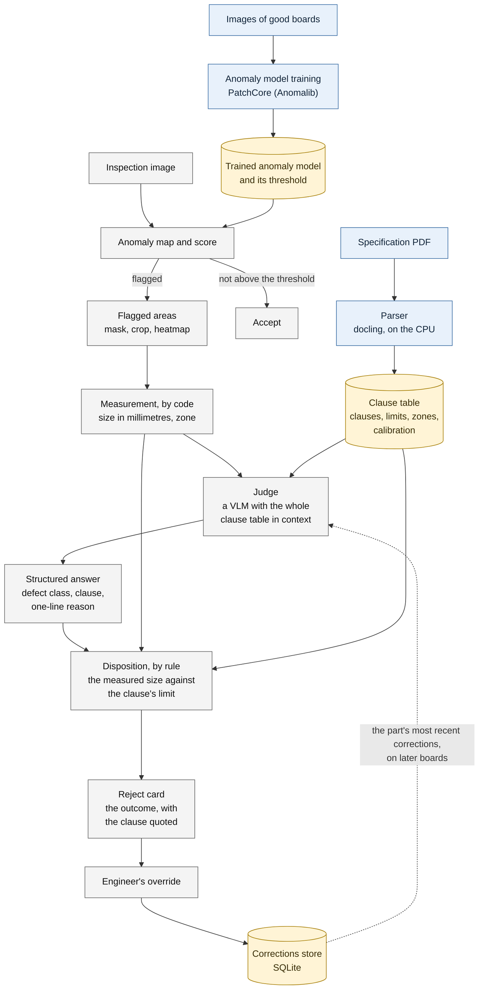
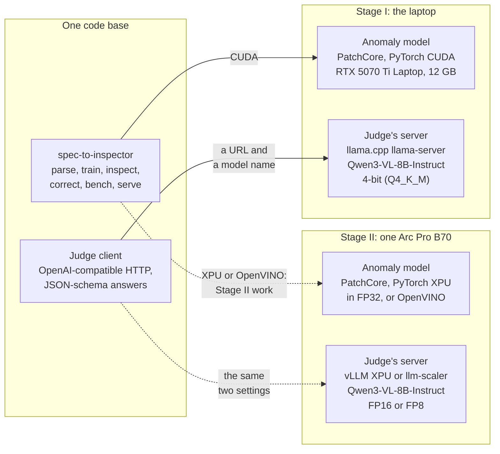

# Architecture

Two diagrams. The first is the pipeline: what happens to a specification
once, and to every board after. The second is the deployment: the laptop
that Stage I was measured on, beside the Intel Arc Pro B70 that Stage II
targets.

## The pipeline

Blue is done once per specification, grey for every board, and yellow is what is
kept on disk between them. The dotted line is the corrections loop.

**The one design rule: no number comes from the language model.** Sizes are
measured by code from the anomaly map's mask, using the calibration the
specification declares. Accept or reject is the clause's limit against that
measurement, decided by code. The model chooses two things only, the defect
class and the clause, and its answer is constrained to a JSON schema. An
answer whose clause does not exist for the part, or whose class is not the
class of the clause it cites, becomes "needs review", never a guess.

What each stage reads and writes:

| Stage | Package | Reads | Writes |
| --- | --- | --- | --- |
| Parse | `spec_to_inspector.spec` | a born-digital PDF | `<name>.clauses.json`: the clauses with their limits, units, zones and page numbers, and the parts' calibrations |
| Train | `spec_to_inspector.anomaly` | the good images of a part | `models/patchcore/<part>/`: the memory bank and its training record, thresholds included |
| Score | `spec_to_inspector.anomaly` | an inspection image | per image: the score, the anomaly map, a mask, numbered regions and their crops |
| Measure | `spec_to_inspector.measure` | a region's mask, the calibration, the zones | longest extent, shortest extent and area in millimetres; the zone |
| Judge | `spec_to_inspector.judge` | the clause table, the measured facts, the crop and its heatmap overlay, up to three corrections | the model's answer: defect class, clause, one sentence |
| Decide | `spec_to_inspector.judge` | the answer, the clause's limit, the measurement | `decision.json`: the outcome, the clause applied, the reason in words written by code |
| Correct | `spec_to_inspector.corrections` | an engineer's override, from the console's form or the `correct` verb | a row in one SQLite file, shown to the judge on later boards of the part |
| Show | `spec_to_inspector.app` | everything above, from disk | four server-rendered pages: Specification, Train, Batch, and the reject card |
| Measure the whole | `spec_to_inspector.bench` | the labelled set in `eval/` | `results/stage1/bench.json` and the page beside it |

The clause table comes first in the judge's prompt and is the same for
every board, so a server with a prefix cache evaluates it once. The
corrections sit before the measured facts for the same reason.

## The deployment

Solid lines are what runs today and was measured on the laptop. Dotted lines are
the Stage II plan for one Intel Arc Pro B70 (32 GB) in the organiser's virtual
machine; nothing has been run on a B70 yet.

- **The judge's backend is a setting, today.** The client speaks the
  OpenAI-compatible chat API over HTTP, so the server behind it is two
  values, `SPEC_TO_INSPECTOR_VLM_URL` and `SPEC_TO_INSPECTOR_VLM_MODEL`.
  Stage I ran llama.cpp on the laptop. Nothing but llama.cpp has been run:
  whether vLLM or llm-scaler accepts the same answer schema under its own
  constrained decoding is the first thing Stage II checks.
- **The anomaly model's device is CUDA, today.** Training and scoring ask
  for the CUDA GPU. Moving them to PyTorch XPU, or exporting to OpenVINO, is
  Stage II's work and is not in this repository yet. Anomalib 2.7.0 has an
  XPU accelerator and an OpenVINO export; neither has been run here.
- **Everything else is the same code.** Parsing runs on the CPU, measurement
  and the rule are plain Python, the corrections store is one SQLite file,
  and the console is server-rendered with no front-end build, so nothing
  needs compiling on the VM.

`docs/stage2.md` has the memory plan per stage on the B70, the assumption
made about the organiser's VM, and what Stage II will measure.
