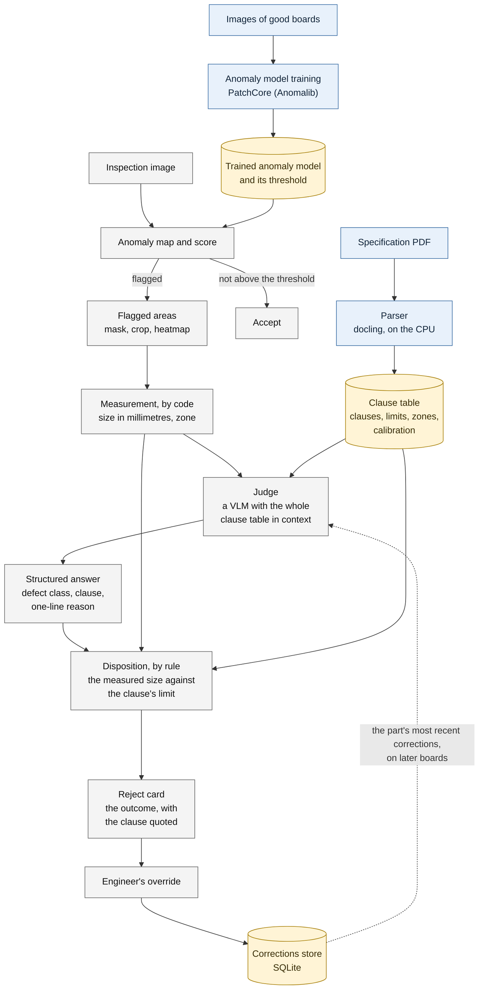
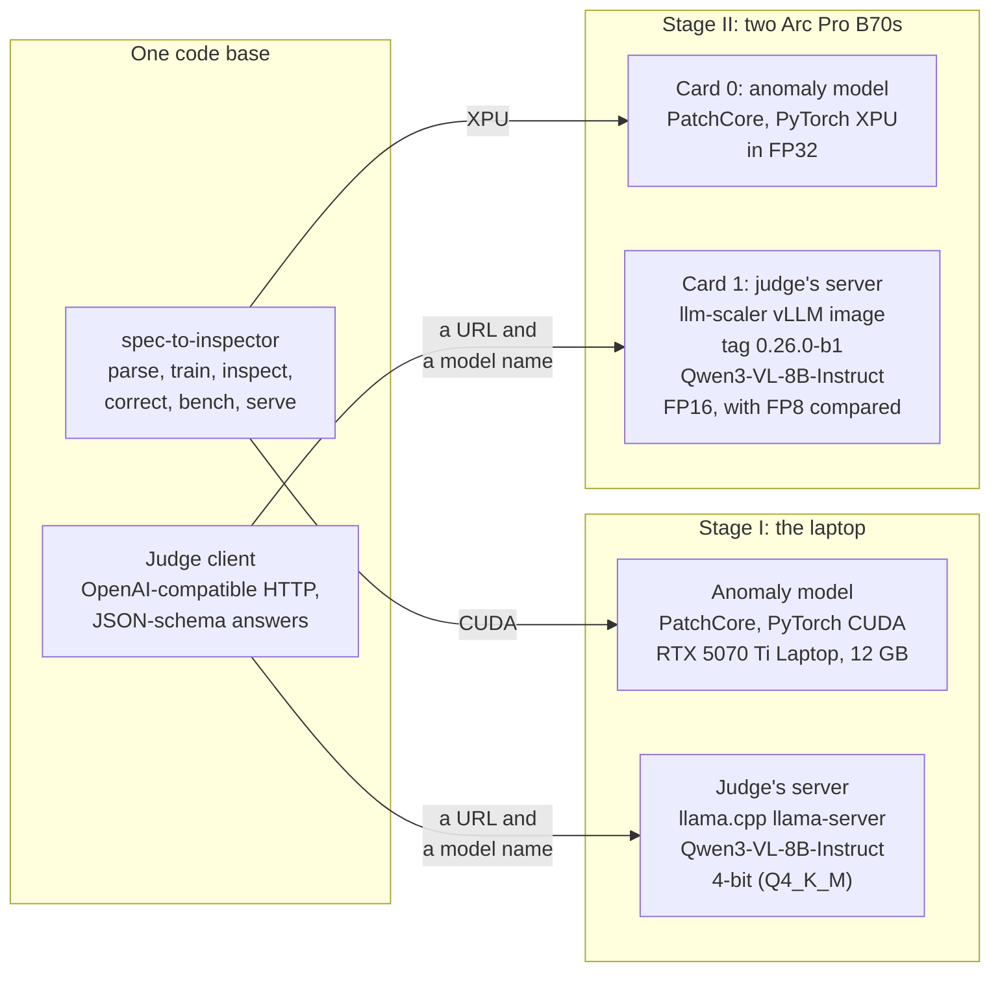

# Architecture

Two diagrams. The first is the pipeline: what happens to a specification
once, and to every board after. The second is the deployment: the two Intel
Arc Pro B70s of the organiser's machine, the subject of Stage II, beside the
laptop that Stage I was measured on.

## The pipeline

Blue is done once per specification, grey for every board, and yellow is what is
kept on disk between them. The dotted line is the corrections loop.

**The one design rule: no number comes from the language model.** Sizes are
measured by code from the anomaly map's mask, using the calibration the
specification declares. Accept or reject is the clause's limit against that
measurement, decided by code. The model chooses two things only, the defect
class and the clause, and its answer is constrained to a JSON schema. An
answer whose clause does not exist for the part, or whose class is not the
class of the clause it cites, becomes "needs review", never a guess.

What each stage reads and writes:

| Stage | Package | Reads | Writes |
| --- | --- | --- | --- |
| Parse | `spec_to_inspector.spec` | a born-digital PDF | `<name>.clauses.json`: the clauses with their limits, units, zones and page numbers, and the parts' calibrations; given the PDF, `inspect` writes the same table into the run's directory as `clauses.json` |
| Train | `spec_to_inspector.anomaly` | the good images of a part | `models/patchcore/<part>/`: the memory bank and its training record, thresholds included |
| Score | `spec_to_inspector.anomaly` | an inspection image | per image: the score, the anomaly map, a mask, numbered regions and their crops |
| Measure | `spec_to_inspector.measure` | a region's mask, the calibration, the zones | longest extent, shortest extent and area in millimetres; the zone |
| Judge | `spec_to_inspector.judge` | the clause table, the measured facts, the crop and its heatmap overlay, up to three corrections | the model's answer: defect class, clause, one sentence |
| Decide | `spec_to_inspector.judge` | the answer, the clause's limit, the measurement | `decision.json`: the outcome, the clause applied, the reason in words written by code |
| Correct | `spec_to_inspector.corrections` | an engineer's override, from the console's form or the `correct` verb | a row in one SQLite file, shown to the judge on later boards of the part |
| Show | `spec_to_inspector.app`; `spec_to_inspector.batch` for the files | everything above, from disk | four server-rendered pages: Specification, Train, Batch, and the reject card; and as files, which `inspect` writes into the run's directory on every form of the verb, `report.html` with its stylesheet and `<image>/reject-card.html` for each rejected board |
| Measure the whole | `spec_to_inspector.bench` | the labelled set in `eval/` | `results/stage1/bench.json` and the page beside it; on the machine, where `eval/PROTOCOL-stage2.md` says |
| Measure a batch | `spec_to_inspector.batch` | the specification's PDF and a part's whole test split, under `inspect --record` | the record named: figures 7, 8 and 9 and the counts, with each card's readings and the server's log beside it |

The clause table comes first in the judge's prompt and is the same for
every board, so a server with a prefix cache evaluates it once. The
corrections sit before the measured facts for the same reason.

## The deployment

Every line has run. On the machine, two whole Intel Arc Pro B70s of 32,656 MiB
each in one bare-metal host (`results/stage2/week1/machine.md`), that means the
judge at FP16, and at FP8 as a declared comparison
(`results/stage2/comparison-fp8/COMPARISON.md`), and PatchCore trained and scored on
XPU in FP32, on all four parts, in two runs (`results/stage2/week2/README.md`).
Anomalib's OpenVINO export has run too and is measured; nothing in the pipeline runs
through it. The bench has run on the models trained on the machine: that is the final
run, on 7 November 2026 (`results/stage2/final/FINAL.md`). So has `inspect`, from the PDF
to the reject cards: that is the whole batch (`results/stage2/batch/README.md`).

- **The judge's backend is a setting.** The client speaks the
  OpenAI-compatible chat API over HTTP, so the server behind it is two
  values, `SPEC_TO_INSPECTOR_VLM_URL` and `SPEC_TO_INSPECTOR_VLM_MODEL`.
  Stage I ran llama.cpp on the laptop. On the machine it is Intel's llm-scaler
  vLLM image at a pinned tag, whose container is given only card 1, and it holds
  to the same answer schema under its own constrained decoding, with one fix:
  the reason's pattern now bars the double quote and the backslash. The server
  needs two more settings of its own, asked cold and a small crop's 1,024 tokens,
  both defaults of `scripts/serve_vlm_xpu.sh`.
- **The anomaly model's device is a setting.** `SPEC_TO_INSPECTOR_DEVICE` is
  `cuda` by default, or `xpu` or `cpu`. On the machine PatchCore runs on PyTorch
  XPU on card 0: each of the four parts trained in two runs, and scored over 802
  boards with scores and maps bit-identical between them. Anomalib reads `devices=1`
  as the card numbered 1, so `engine_placement` passes `[0]`, and anomaly work runs
  under `ZE_AFFINITY_MASK=0`. Anomalib's OpenVINO export is in `anomaly/ov_model.py`,
  on `GPU.0` in FP32, which has to be asked for: the plugin infers in FP16 unasked. It
  is measured beside PyTorch XPU, at about half the speed and, at batch 16, about six
  times the memory on the card, and only `anomaly/card_run.py` runs it. Memory is
  read through `card_memory.py`, from `xpu-smi` on the machine and `nvidia-smi` on the
  laptop, chosen by the device; `SPEC_TO_INSPECTOR_VLM_CARD` names the judge's card,
  and the judge's own process stays null on the machine, since `xpu-smi` does not list
  a process in a container. One lockfile holds both environments, as two dependency
  groups, `cuda` by default and `xpu` by `scripts/setup_xpu.sh`.
- **Everything else is the same code.** Parsing runs on the CPU, measurement
  and the rule are plain Python, the corrections store is one SQLite file,
  and the console is server-rendered with no front-end build, so nothing
  needs compiling on the machine.

`docs/stage2.md` has the memory plan per stage on the machine, what the plan
assumed about it before it was seen, and what Stage II will measure.
`eval/PROTOCOL-stage2.md`, with its dated additions, is how it is measured.
