# Workmanship acceptance specification: PCB1 and PCB4 assemblies

Demonstration document WS-PCB-014, revision A, 10 October 2026. Written for the Spec to Inspector entry to the ASUS UGen AI League hackathon, in the style of a customer's workmanship specification. It is not a real customer's document: its parts are the boards photographed in the public VisA dataset, its limits are illustrative, and it neither quotes nor paraphrases any published standard.

## 1 Scope

This specification states the visual acceptance criteria for two assembled circuit boards supplied to the customer: part PCB1, an ultrasonic ranging module, and part PCB4, a single-cell charger module with a micro USB receptacle. It applies at final visual inspection of the component side of each board, from one image per board taken from directly above.

Each defect found on a board is judged on its own against the one clause that names its defect class and the zone it lies in. A board is conforming when no clause rejects any of its defects; one rejected defect rejects the board. A defect that fits no clause of its part, or that lies outside every zone, is referred to the customer's quality engineer for review and is neither accepted nor rejected by the supplier.

## 2 Definitions

- **Defect class**: the name of a kind of defect, written in lower case exactly as inspection records carry it. The classes of a part are those named in its clauses.
- **Size**: the longest extent of a defect, which is the long side of the smallest rectangle, at any angle, that encloses the defect's visible area. Every limit given in millimetres in this document is a limit on size.
- **Zone**: a named rectangle of the inspection image, declared in section 3.2. A defect belongs to the zone its centre lies in. Where zones overlap, or a defect lies across more than one zone, the most critical of those zones applies.
- **Any**: written in place of a zone, it means the clause applies wherever on the part the defect lies.
- **Limit**: the bound on size beyond which a defect is nonconforming. "1.0 mm max" means a size up to and including 1.0 mm is acceptable and a larger one is not. "> 1.0 mm" means the defect is nonconforming when its size is greater than 1.0 mm. The two spellings state the same rule. "Not permitted" means the defect is nonconforming at any size.
- **Disposition**: what is done with a nonconforming defect. "Reject" means the board is rejected and is not shipped.

---

## 3 Calibration and zones

### 3.1 Calibration

Each part is imaged from directly above at a fixed working distance, with the whole board in the frame and a margin of fixture around it. The table declares the nominal width of each board and the width and height of the scene that the full image covers. A horizontal length in the image is converted to millimetres by the imaged width divided by the image's width in pixels, and a vertical length by the imaged height divided by the image's height in pixels.

| Part | Board width (mm) | Imaged width (mm) | Imaged height (mm) |
| --- | --- | --- | --- |
| PCB1 | 45.0 | 66.9 | 51.0 |
| PCB4 | 25.0 | 46.7 | 38.0 |

### 3.2 Zones

Zones are rectangles in normalised image coordinates. The value x runs from 0 at the left edge of the image to 1 at its right edge, and y runs from 0 at the top edge to 1 at the bottom edge. The corner (x0, y0) is a zone's top left and (x1, y1) its bottom right. The zones of each part are listed with the most critical first. Part PCB1 is presented to the camera either way round, with its header pins towards the top or towards the bottom of the image, so its zones are drawn to hold in both presentations.

| Part | Zone | Covers | x0 | y0 | x1 | y1 |
| --- | --- | --- | --- | --- | --- | --- |
| PCB1 | A | Header pins, their solder joints and the crystal | 0.33 | 0.11 | 0.63 | 0.89 |
| PCB1 | B | Board face and transducers | 0.06 | 0.25 | 0.89 | 0.75 |
| PCB4 | A | Components and their solder joints | 0.41 | 0.13 | 0.85 | 0.77 |
| PCB4 | B | USB receptacle | 0.15 | 0.26 | 0.41 | 0.61 |
| PCB4 | C | Input pads and board margin | 0.15 | 0.13 | 0.85 | 0.77 |

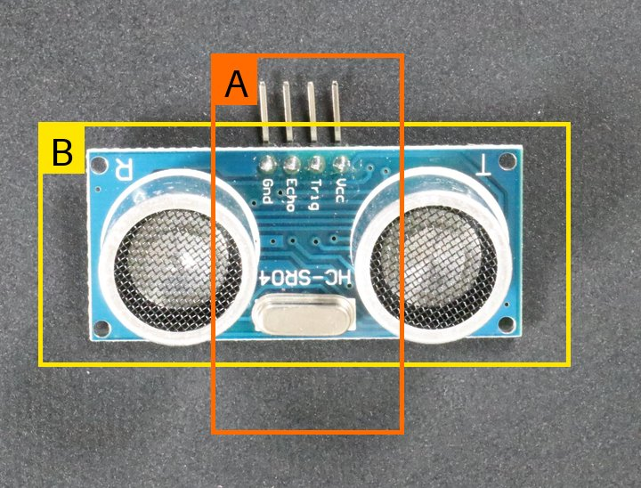

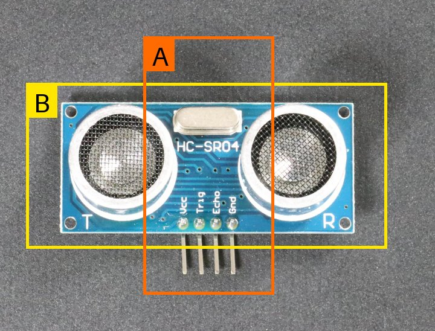

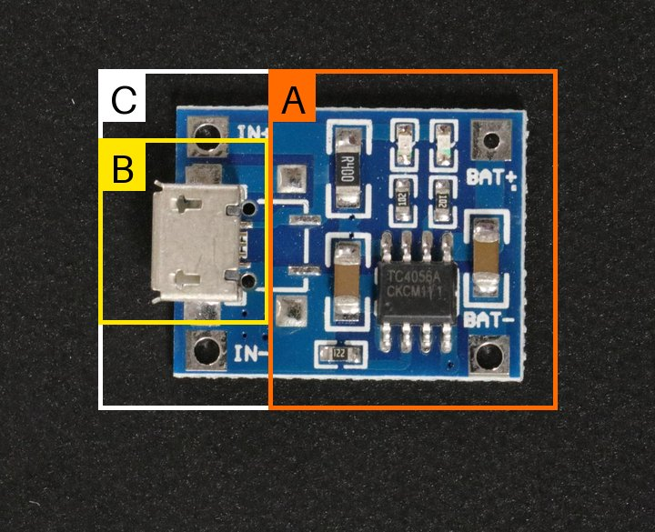

---

## 4 Acceptance criteria for part PCB1

### 4.1 Stray or bridging solder

Solder that has flowed or splashed to where the design puts none is nonconforming at any size and in any zone. This covers a lump or bridge of solder joining two header pins or two pads, and solder lying on a component body or on the bare board.

| Clause | Defect class | Zone | Limit | Disposition |
| --- | --- | --- | --- | --- |
| 4.1 | melt | Any | Not permitted | Reject |

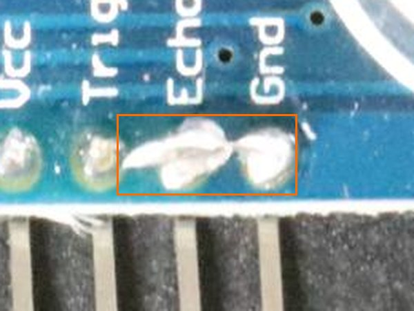

### 4.2 Scratch

A scratch is a line cut or scored into the surface of the board. It is nonconforming when its size exceeds the limit of the zone it lies in. Several scratches that touch or cross are measured together as one defect.

| Clause | Defect class | Zone | Limit | Disposition |
| --- | --- | --- | --- | --- |
| 4.2.1 | scratch | A | 1.0 mm max | Reject |
| 4.2.2 | scratch | B | 2.0 mm max | Reject |

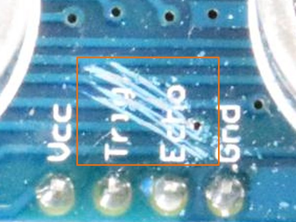

### 4.3 Missing component

Every component of the assembly shall be present: both transducers with their mesh covers, the crystal and the four header pins. An absent component, or a transducer without its cover, is nonconforming in any zone.

| Clause | Defect class | Zone | Limit | Disposition |
| --- | --- | --- | --- | --- |
| 4.3 | missing | Any | Not permitted | Reject |

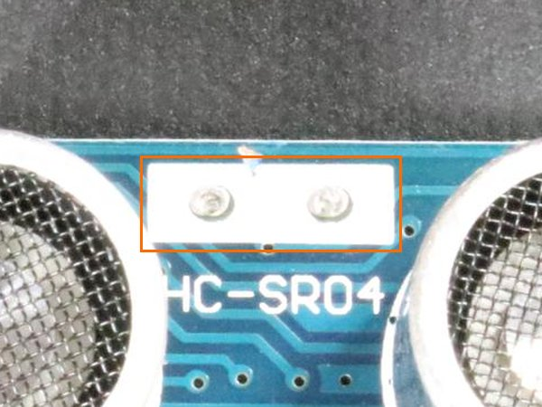

### 4.4 Bent header pin

The four header pins shall be straight, parallel to one another and square to the board edge. A pin bent out of line with its neighbours, or touching another pin, is nonconforming at any angle of bend.

| Clause | Defect class | Zone | Limit | Disposition |
| --- | --- | --- | --- | --- |
| 4.4 | bent | Any | Not permitted | Reject |

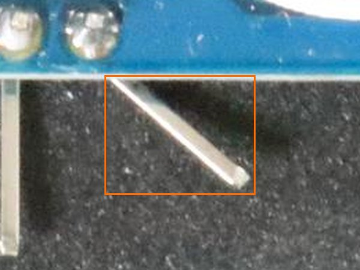

---

## 5 Acceptance criteria for part PCB4

### 5.1 Foreign material

Foreign material is anything on the part that does not belong to it and is not a component: dirt, residue, corrosion spots or tarnish. It is nonconforming when its size exceeds the limit of the zone it lies in. Spots that touch are measured together as one defect.

| Clause | Defect class | Zone | Limit | Disposition |
| --- | --- | --- | --- | --- |
| 5.1.1 | dirt | A | > 0.5 mm | Reject |
| 5.1.2 | dirt | B | > 1.0 mm | Reject |
| 5.1.3 | dirt | C | > 2.0 mm | Reject |

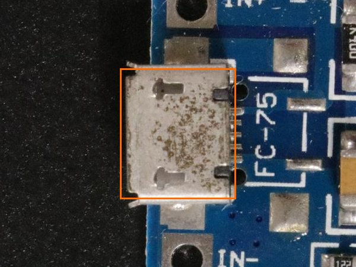

### 5.2 Missing component

Every component of the assembly shall be present on its pads: the receptacle, the charger integrated circuit, and each resistor, capacitor and indicator. An absent component is nonconforming in any zone.

| Clause | Defect class | Zone | Limit | Disposition |
| --- | --- | --- | --- | --- |
| 5.2 | missing | Any | Not permitted | Reject |

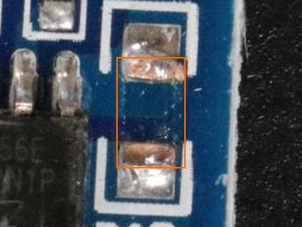

### 5.3 Extra component or object

Nothing shall be attached to the part beyond the components of the assembly. A component on pads the design leaves empty, a loose part, a fragment of plastic or a lump of solder or adhesive is nonconforming at any size and in any zone.

| Clause | Defect class | Zone | Limit | Disposition |
| --- | --- | --- | --- | --- |
| 5.3 | extra | Any | Not permitted | Reject |

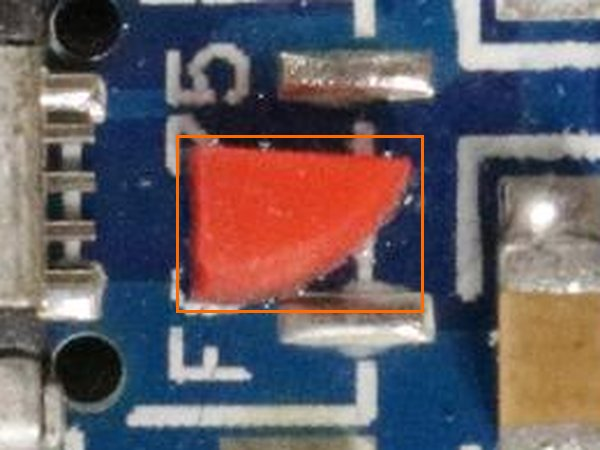

### 5.4 Misplaced component

Each component shall sit square on its own pads. A component that is shifted off its pads, turned from its drawn orientation or standing on one end is nonconforming at any offset and in any zone.

| Clause | Defect class | Zone | Limit | Disposition |
| --- | --- | --- | --- | --- |
| 5.4 | wrong place | Any | Not permitted | Reject |

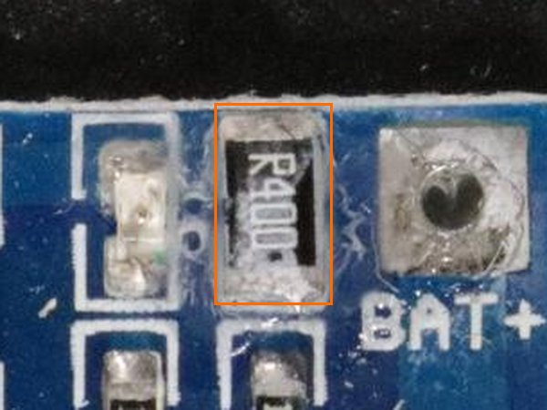

### 5.5 Damaged component or board

Damage is a break in the material of a component or of the board: a torn or crushed receptacle shell, a cracked or chipped component body, a lifted pad or a gouge through the board surface. It is nonconforming at any size and in any zone.

| Clause | Defect class | Zone | Limit | Disposition |
| --- | --- | --- | --- | --- |
| 5.5 | damage | Any | Not permitted | Reject |

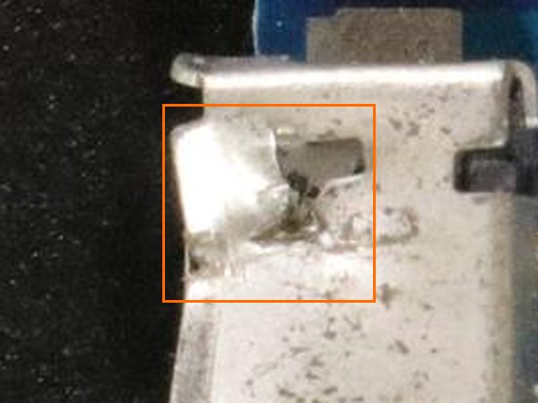

### 5.6 Scratch

A scratch is a line cut or scored into the surface of the board or of a component. It is nonconforming when its size exceeds the limit of the zone it lies in. Several scratches that touch or cross are measured together as one defect.

| Clause | Defect class | Zone | Limit | Disposition |
| --- | --- | --- | --- | --- |
| 5.6.1 | scratch | A | > 1.0 mm | Reject |
| 5.6.2 | scratch | B | > 2.0 mm | Reject |
| 5.6.3 | scratch | C | > 3.0 mm | Reject |

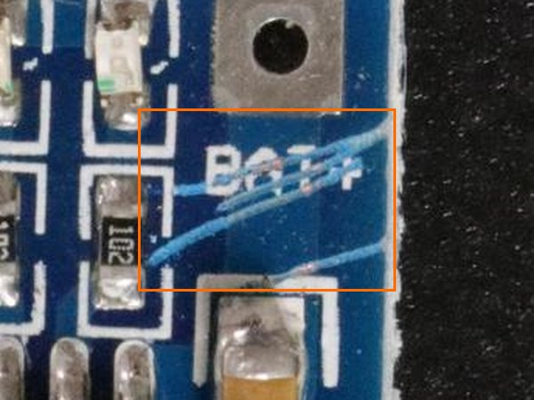

### 5.7 Burn mark

A burn mark is material charred or blackened by heat, on a component or on the board. It is nonconforming at any size and in any zone.

| Clause | Defect class | Zone | Limit | Disposition |
| --- | --- | --- | --- | --- |
| 5.7 | burnt | Any | Not permitted | Reject |

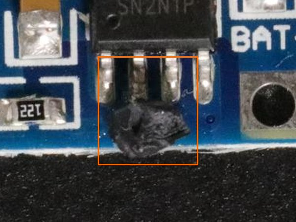

## 6 Image sources

Every photograph in this document is from the VisA dataset (Zou, Jeong, Pemula, Zhang and Dabeer, "SPot-the-Difference Self-Supervised Pre-training for Anomaly Detection and Segmentation", ECCV 2022), published by Amazon under the Creative Commons Attribution 4.0 licence. Each is cropped, resized or drawn over for this document; the caption of each figure names the category and the image it is taken from, normal or anomaly, by its number.
